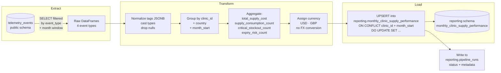

# PIPELINE_DESIGN.md — Business Performance Data Pipeline
## HealthCore · Monthly Clinic Supply Performance Report

---

## Run Command

```bash
# From the monorepo root, with the API venv active:
source services/api/.venv/bin/activate
python data/pipelines/pipeline.py                    # processes previous calendar month
python data/pipelines/pipeline.py --month 2026-07-01 # processes a specific month
```

**Schedule:** `CronSchedule("0 6 1 * *")` — 06:00 UTC on the first day of each month,
so the board pack is ready by the first working day.

**Dependencies required:** `prefect>=3`, `pandas`, `sqlalchemy`, `psycopg2-binary`, `python-dotenv`
(all present in `services/api/pyproject.toml`; install prefect with `uv add "prefect>=3"`).

---

## Phase 1 — Current State

### What we already have

The telemetry system captures events from three sources (API, backoffice frontend, and a daily scheduler job) and stores them in a single append-only table:

```
public.telemetry_events
  id          uuid          primary key   -- envelope eventId (dedup key)
  timestamp   timestamptz   not null
  service     text          not null      -- api | backoffice | scheduler
  event_type  text          not null
  level       text          not null      -- info | warn | error
  value       numeric
  message     text
  tags        jsonb         not null      -- allowlisted payload fields
```

Five mandatory business events are captured:

| event_type | Source | Cadence |
|---|---|---|
| `inbound_order_created` | API — `POST /inventory/orders/inbound` | batch, hourly |
| `outbound_order_created` | API — `POST /inventory/orders/outbound` | batch, hourly |
| `stock_threshold_triggered` | API — same transaction as outbound order | stream, <1 min |
| `direct_stock_edit_rejected` | API — guard routes on inventory | stream, <1 min |
| `supply_expiry_flagged` | Scheduler — daily `expiry_scan` job at 06:00 local | batch, daily |

The existing technical report (`services/telemetry/analysis.py` → `GET /telemetry/report`) computes operational metrics for the engineering team: event volume by type, API error rates, latency percentiles, and auth event counts. It answers questions like "how many events did we process today?" and "what is our API error rate?".

### The business gap

The technical report does not answer any of the questions Dr. Okonkwo and Claire need:

- How much did each clinic spend on medical supplies last month?
- Which clinics ran out of critical supplies, and how often?
- Where is expiry waste concentrated across the network?
- Is Austin North consuming more supplies than Miami, or is it just better at capturing data?

No existing report, endpoint, or dashboard produces these numbers. The board pack is currently assembled by hand from spreadsheets — a process that takes two days and is already outdated by the time it arrives. The five mandatory telemetry events contain exactly the data needed to answer these questions automatically, but nothing reads them for business purposes today.

---

## Phase 2 — Pipeline Design

### Purpose

This pipeline exists to **produce the Monthly Clinic Supply Performance Report** — a per-clinic, per-country monthly rollup of supply cost, consumption volume, stockout frequency, and expiry risk — that feeds Dr. Okonkwo's board pack and Claire's compliance review, computed automatically from `telemetry_events` by the first working day of each month.

**KPIs it computes (from the data-pipelines BRIEFING):**

| KPI | Field in destination | Source event |
|---|---|---|
| Supply Cost per Clinic | `total_supply_cost` | `inbound_order_created` |
| Supply Consumption Volume | `supply_consumption_count` | `outbound_order_created` |
| Critical Stockout Frequency | `critical_stockout_count` | `stock_threshold_triggered` |
| Expiry Risk Count | `expiry_risk_count` | `supply_expiry_flagged` |

### Telemetry schema extension

`inbound_order_created` currently does not carry a cost field. Per the BRIEFING, adding one is an **additive extension of an existing mandatory event** — not a new event type, and not a modification to the technical report. The `tags` JSONB object for this event must be extended with:

```json
{
  "unit_cost": 4.75,
  "total_cost": 190.00,
  "currency": "USD"
}
```

`total_cost = quantity × unit_cost`. Currency is `USD` for US clinics and `GBP` for UK clinics. This field never contains patient data — it describes a supply delivery cost.

### Extraction

**Source:** `public.telemetry_events` (read-only SELECT; this pipeline never writes to it).

**Relevant event types:** `inbound_order_created`, `outbound_order_created`, `stock_threshold_triggered`, `supply_expiry_flagged`. (`direct_stock_edit_rejected` is a compliance event and feeds no KPI in v1.)

**Payload fields used per event:**

| event_type | Tags fields read |
|---|---|
| `inbound_order_created` | `clinic_id`, `country`, `total_cost`, `currency` |
| `outbound_order_created` | `clinic_id`, `country` |
| `stock_threshold_triggered` | `clinic_id`, `country` |
| `supply_expiry_flagged` | `clinic_id`, `country` |

**Extraction query pattern** (one per event type, same window):

```sql
SELECT timestamp, event_type,
       tags->>'clinic_id'  AS clinic_id,
       tags->>'country'    AS country,
       tags->>'total_cost' AS total_cost,
       tags->>'currency'   AS currency
FROM   public.telemetry_events
WHERE  event_type = $1
  AND  timestamp >= $month_start
  AND  timestamp <  $month_end;
```

The window is always `[month_start, month_end)` — UTC, closed on the left, open on the right — so re-runs on the same window are deterministic.

**Update cadence of the source:** `telemetry_events` is append-only (triggers block UPDATE and DELETE). There are no updates to existing records to reconcile — only late-arriving inserts (see Phase 3).

### Data flow



**Stage descriptions:**

**Extract** — Four filtered SELECT queries against `telemetry_events`, one per event type, all scoped to the same month window. Result: four Pandas DataFrames loaded into memory. The source table is never modified.

**Transform** — Each DataFrame goes through the same normalization pipeline: (1) parse `tags` JSONB fields into typed columns (`clinic_id` as text, `total_cost` as float, `currency` as text); (2) drop rows where `clinic_id` is null (miscaptured events cannot be attributed to a clinic and are excluded, logged as a data-quality warning); (3) group by `clinic_id` + `country` + `month_start`; (4) aggregate: sum `total_cost` for inbound, count rows for the other three event types; (5) assign `currency` from the event payload (`USD` for US clinics, `GBP` for UK clinics — never mixed in a single row). The four aggregated DataFrames are then merged into a single clinic×month grid.

**Load** — Single UPSERT into `reporting.monthly_clinic_supply_performance` using the unique constraint on `(clinic_id, month_start)`. Every row that already exists for that clinic-month is fully overwritten (DO UPDATE SET all KPI fields). This makes re-runs safe by design. After the UPSERT, the pipeline writes one row to `reporting.pipeline_runs` recording the run's outcome.

### Handling source updates / deduplication

`telemetry_events` is append-only: existing rows are never updated or deleted. The deduplication concern is **duplicate inserts** — the same event arriving twice with the same `eventId` (the table's primary key). This is handled at ingest time by the `POST /telemetry` collector, which performs a bulk INSERT using `ON CONFLICT (id) DO NOTHING`. The pipeline therefore reads a deduplicated source and does not need a second dedup layer.

The only remaining concern is **late-arriving events**: an event whose `timestamp` falls in a closed month window but that was inserted into `telemetry_events` after the pipeline already ran for that month. The pipeline handles this via its upsert strategy: re-running the pipeline for a past month window recomputes the aggregates from scratch and overwrites the destination row cleanly. The recomputed run is logged in `pipeline_runs` with the reason `late_event_recompute`, preserving the audit trail of the original run.

---

## Phase 3 — Resilience and Idempotency

### Idempotency strategy

The unique constraint `UNIQUE (clinic_id, month_start)` on the destination table is the idempotency anchor. The load step uses:

```sql
INSERT INTO reporting.monthly_clinic_supply_performance (
  clinic_id, country, month_start,
  total_supply_cost, supply_consumption_count,
  critical_stockout_count, expiry_risk_count,
  currency, computed_at
) VALUES (...)
ON CONFLICT (clinic_id, month_start)
DO UPDATE SET
  total_supply_cost        = EXCLUDED.total_supply_cost,
  supply_consumption_count = EXCLUDED.supply_consumption_count,
  critical_stockout_count  = EXCLUDED.critical_stockout_count,
  expiry_risk_count        = EXCLUDED.expiry_risk_count,
  currency                 = EXCLUDED.currency,
  computed_at              = EXCLUDED.computed_at;
```

**What happens on a second run after a load-phase failure:**

Suppose the pipeline ran for 2026-07-01 and loaded 7 of 12 clinic rows before Supabase dropped the connection. The partial 7 rows are already in the destination table. On re-run:

1. Extract re-reads the full month window from `telemetry_events` (same query, same window → same result).
2. Transform recomputes all 12 clinic aggregates identically.
3. Load upserts all 12 rows. The 7 already-present rows are overwritten with the same values (no data corruption, no duplicates). The remaining 5 are inserted fresh.

The result is identical to a clean run. No manual intervention, no rollback needed.

### Execution log

Every pipeline run — scheduled or manually triggered — writes one row to `reporting.pipeline_runs` before returning.

**Table DDL:**

```sql
CREATE TABLE reporting.pipeline_runs (
  run_id               uuid          PRIMARY KEY DEFAULT gen_random_uuid(),
  flow_name            text          NOT NULL,
  month_start          date          NOT NULL,
  started_at           timestamptz   NOT NULL,
  ended_at             timestamptz,
  status               text          NOT NULL CHECK (status IN ('running','completed','failed')),
  records_read         integer,
  records_written      integer,
  clinics_processed    integer,
  error_message        text,
  prefect_flow_run_id  text
);
```

**Field justification:**

| Field | Type | Why it's necessary |
|---|---|---|
| `run_id` | uuid | Unique identifier for every run. Correlates log entries with Prefect task states and API responses to `/reporting/pipeline-runs/latest`. |
| `flow_name` | text | Identifies which pipeline produced this run. Required once more than one pipeline writes to `pipeline_runs` (v2+). |
| `month_start` | date | Names the data window this run processed. Without this, you cannot tell whether a run processed July or June data, making audit of late-event recomputes impossible. |
| `started_at` | timestamptz | Timestamps the beginning of the run. Combined with `ended_at`, gives wall-clock duration. Essential for detecting hung runs (started but no ended_at after N minutes). |
| `ended_at` | timestamptz | Timestamps completion or failure. Null means the run is still in progress or crashed without cleanup. A null `ended_at` with a stale `started_at` triggers a hung-run alert. |
| `status` | text | Machine-readable outcome: `running` while executing, `completed` on success, `failed` on error. The `GET /reporting/pipeline-runs/latest` endpoint exposes this directly. |
| `records_read` | integer | Total events read from `telemetry_events` across all four event types. A sudden drop versus prior months is the first signal of a telemetry capture gap, not a business drop. |
| `records_written` | integer | Rows upserted into `monthly_clinic_supply_performance`. Should equal 12 (one per clinic) in a healthy run. Fewer rows means some clinics had no events — worth flagging. |
| `clinics_processed` | integer | Count of distinct `clinic_id` values in the output. Separates "wrote 12 rows" from "wrote 12 rows for 12 distinct clinics" — protects against a grouping bug that collapses all clinics into one. |
| `error_message` | text | Full exception message when `status = 'failed'`. Stored here so the API can surface it without requiring access to Prefect's UI or server logs. |
| `prefect_flow_run_id` | text | The Prefect flow run UUID. Links this log row to the full Prefect execution trace — task states, retries, artifacts — for deep debugging. |

---

## Phase 4 — Mapping to Prefect

### Flow and task structure

```
monthly_clinic_supply_performance_flow  (main flow)
│
├── task: extract_telemetry_events
│       Runs 4 filtered SELECT queries against telemetry_events.
│       Returns 4 DataFrames (one per event type).
│       On failure → flow state: Failed. Run logged as failed.
│
├── task: transform_to_clinic_monthly_aggregates
│       Normalizes, groups, and aggregates the 4 DataFrames.
│       Returns a single merged DataFrame (one row per clinic).
│       On failure → flow state: Failed. Partial output discarded (never touched DB).
│
├── task: load_to_reporting_table
│       Executes the UPSERT batch into monthly_clinic_supply_performance.
│       On failure → flow state: Failed. Re-run is safe (idempotent upsert).
│
└── task: log_pipeline_run
        Writes the run record to reporting.pipeline_runs regardless of upstream state.
        Runs in a finally-equivalent pattern so it always executes.
        On failure → logs the error_message; does not raise (avoids masking the real failure).
```

**Relevant Prefect states:**

- `Running` — flow has started; `pipeline_runs.status = 'running'` is written at the start of `log_pipeline_run`'s init call.
- `Completed` — all three pipeline tasks finished successfully; `pipeline_runs.status = 'completed'`.
- `Failed` — any task raised an exception; Prefect marks the flow Failed; `log_pipeline_run` catches the state and writes `status = 'failed'` with `error_message`.
- `Crashed` — Prefect runner process died unexpectedly; `ended_at` stays null and `status` stays `'running'` — a stale `started_at` (> 2 hours old with status still `'running'`) triggers a monitoring alert.

**Schedule:** `@flow` decorated with a Prefect `CronSchedule("0 6 1 * *")` — runs at 06:00 UTC on the first day of each month. This targets the board pack deadline (first working day of the month).

**Concurrency guard:** Prefect's `concurrency_limit=1` on the deployment prevents a scheduled run and a manual trigger from overlapping. The second trigger is queued, not dropped.

### Prefect Blocks

| Block type | Name | Used for |
|---|---|---|
| `SqlAlchemyConnector` | `supabase-reporting-db` | SQLAlchemy engine for both reading `telemetry_events` and writing to `reporting.*`. Credentials (host, port, user, password, dbname) stored encrypted in Prefect Cloud; never hardcoded. |
| `Secret` | `supabase-service-key` | Supabase service-role key for any direct REST calls outside SQLAlchemy (e.g., future webhook notifications). |

Both blocks are loaded at flow startup via `Block.load("supabase-reporting-db")` — the pipeline code contains no credentials.

---

## Phase 5 — Application Integration (Design Only)

### New endpoints in `services/reporting/`

This module is entirely separate from `services/telemetry/`. It never imports from `services/telemetry/analysis.py` and shares only the database engine.

**Directory layout:**

```
services/reporting/
├── __init__.py
├── router.py          # FastAPI APIRouter(prefix="/reporting")
└── queries.py         # Read-only SELECT functions against reporting.*
```

The FastAPI main app registers this router with `app.include_router(reporting_router)`.

---

#### `GET /reporting/monthly-clinic-supply-performance` — KPI query

**Purpose:** returns the computed KPIs for all 12 clinics for a given month. This is what the dashboard (Part 3) will consume.

**Query param:** `month_start` (optional ISO date, e.g. `2026-07-01`). Defaults to the most recently completed month in the table.

**Response shape:**
```json
{
  "month_start": "2026-07-01",
  "clinics": [
    {
      "clinic_id": "austin-north",
      "country": "US",
      "total_supply_cost": 18420.50,
      "supply_consumption_count": 340,
      "critical_stockout_count": 1,
      "expiry_risk_count": 4,
      "currency": "USD"
    }
  ]
}
```

**Function it calls:** `queries.get_monthly_clinic_performance(month_start: date, engine: Engine) -> list[dict]`

This function does a plain SELECT from `reporting.monthly_clinic_supply_performance` filtered by `month_start`. No ETL logic belongs here.

---

#### `GET /reporting/pipeline-runs/latest` — status query

**Purpose:** returns the metadata of the most recent pipeline run. Used by the backoffice to display pipeline health without requiring access to Prefect's UI.

**Response shape:**
```json
{
  "run_id": "a3f9e1b2-...",
  "flow_name": "monthly_clinic_supply_performance_flow",
  "month_start": "2026-07-01",
  "started_at": "2026-07-01T06:00:12Z",
  "ended_at": "2026-07-01T06:04:38Z",
  "status": "completed",
  "records_read": 4821,
  "records_written": 12,
  "clinics_processed": 12,
  "error_message": null
}
```

**Function it calls:** `queries.get_latest_pipeline_run(engine: Engine) -> dict`

SELECT from `reporting.pipeline_runs` ORDER BY `started_at DESC` LIMIT 1. No ETL logic.

---

#### `POST /reporting/pipeline-runs` — manual trigger

**Purpose:** allows an authorised operator (or the backoffice UI) to trigger a pipeline run on demand — for example, to recompute a past month after late events arrive, without waiting for the cron schedule.

**Request body:**
```json
{
  "month_start": "2026-06-01"
}
```

**Response:** `202 Accepted` with the new `run_id`.

**Function it calls:** `data/pipelines/supply_performance_pipeline.py` → `monthly_clinic_supply_performance_flow.run(month_start=...)`

This endpoint is the only place that triggers orchestration code. No transformation logic lives in `services/` — the router calls the Prefect flow directly and returns immediately. The flow runs asynchronously; the caller polls `GET /reporting/pipeline-runs/latest` to track progress.

**Auth:** requires the same bearer token as `POST /telemetry/events` — clinic administrators and above. Anonymous callers receive `401 Unauthorized`.

---

## Answers to design questions

### Idempotency

**1. Duplicates at the source.** The `telemetry_events` table uses `id = eventId` as its primary key with `ON CONFLICT (id) DO NOTHING` at ingest. If the same event arrives twice (e.g., a client retry), the second insert is silently dropped at the collector. The pipeline reads a deduplicated source and never needs to dedup again. The dedup key is `eventId` from the event envelope, resolved at ingest.

**2. Re-run after failure.** The load step uses `ON CONFLICT (clinic_id, month_start) DO UPDATE SET ...`. If the pipeline fails during load with 7 of 12 rows inserted, the next run re-extracts the full window, re-computes all 12 aggregates, and upserts all 12 rows. The 7 existing rows are overwritten with identical values; the remaining 5 are inserted. Result is identical to a clean run.

**3. Late events.** A delayed `supply_expiry_flagged` event arriving with a July `timestamp` after the July run has already completed does not corrupt any data — `telemetry_events` simply gets a new row. To incorporate it, an operator (or an automated late-event detector) triggers `POST /reporting/pipeline-runs` with `{"month_start": "2026-07-01"}`. The pipeline re-runs the July window, picks up the late event, recomputes, and upserts the corrected row. The original run row in `pipeline_runs` is preserved; a new run row is added with `flow_name = "monthly_clinic_supply_performance_flow"` and a note in `error_message` such as `"late_event_recompute"`.

### Observability

**4. Silence vs. true absence.** `records_read` in `pipeline_runs` distinguishes zero business activity from a capture failure: if `records_read = 0` for a month in which clinics were operating, the pipeline completed but nothing was captured — a telemetry gap, not a business one. Additionally, the `supply_expiry_flagged` event is emitted by a daily scheduler job regardless of clinic activity. If that event type shows zero rows in a month, the scheduler job failed, not the clinics. A monitoring alert fires when `records_read < expected_minimum` (a configurable threshold based on historical baseline, e.g. 500 events/month minimum).

**5. Collection traceability.** Every event in `telemetry_events` carries a `requestId` in `tags`. Every pipeline run has a `run_id`. The path from raw event to business aggregate is: `telemetry_events.id` (eventId) → aggregated into `monthly_clinic_supply_performance` for `(clinic_id, month_start)` → produced by run `pipeline_runs.run_id`. If a metric spikes, correlate `tags->>'requestId'` clusters in `telemetry_events` against the `started_at`/`ended_at` window in `pipeline_runs` to determine whether a burst of real events or a double-processed batch caused it.

**6. Growth vs. data loss.** Compare `records_read` across consecutive monthly runs in `pipeline_runs`. A drop that coincides with a known low-activity period (e.g., UK public holidays) is expected. A drop without explanation should be compared against `supply_consumption_count` per active clinic: if a clinic's consumption count drops to zero while it is known to be open, the likely cause is a `POST /inventory/orders/outbound` outage, not a business drop.

### Recoverability

**7. Database outage.** The phase checkpoint is implicit: `load_to_reporting_table` is a single atomic UPSERT batch. If Supabase drops mid-insert, Prefect marks the task `Failed`, the flow state becomes `Failed`, and `log_pipeline_run` records the error. On re-run, the extract and transform tasks re-execute from scratch (they are side-effect-free), and the load task retries the full UPSERT. No intermediate state needs to be persisted because the UPSERT is idempotent.

**8. Frontend buffer.** Not applicable to this pipeline — it has no browser-facing component. The concern is relevant to the `POST /telemetry` collector, which accepts batched events from the backoffice. If a clinic's browser goes offline, the backoffice should buffer events in localStorage and flush on reconnect. The collector handles dedup server-side via `ON CONFLICT (id) DO NOTHING`, so a 45-event reconnect batch is safe even if some events were already received on the slow first attempt.

**9. Transmission retry.** The `POST /telemetry` collector is the entry point for telemetry. It is idempotent by design: if the client retries because of a timeout, the second request finds the event already stored (same `eventId`) and the collector returns `200 OK` with `{"stored": 0, "rejected": 0}` — meaning "already processed, nothing to do." The client interprets any `2xx` response as success and stops retrying. `409 Conflict` is not used because the collector's contract is "best effort, no duplicates" rather than "fail loudly on retry."

### Cross-cutting

**10. Concurrent runs.** The Prefect deployment is configured with `concurrency_limit=1`. If a cron trigger fires at 06:00 and an operator clicks "Run pipeline now" at 06:05, the second run is queued in Prefect and waits for the first to complete or fail. Both runs generate distinct `run_id` values. The load step's UPSERT constraint ensures that even if two runs somehow executed simultaneously against the same month window, the result would be the last-writer-wins value from `telemetry_events` — deterministic because both reads are identical for the same window.
