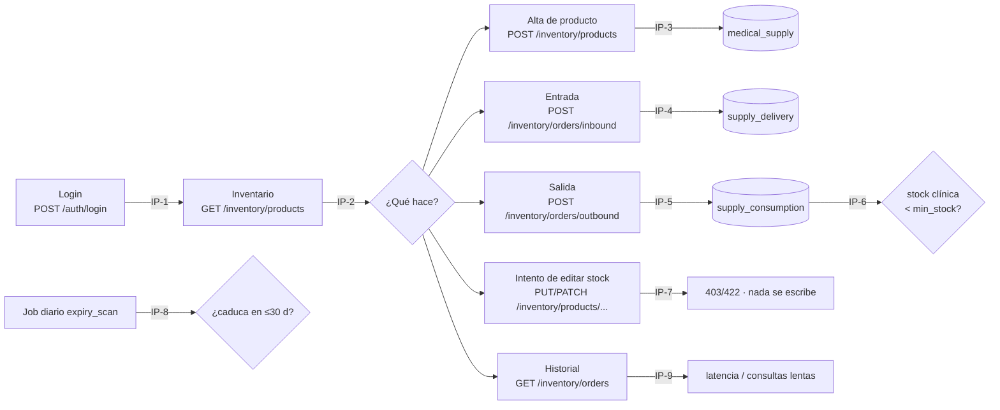

# Telemetry Plan — HealthCore

**Respuesta al RFI de Dirección: "¿puede el sistema generar información de negocio accionable?"**

| | |
|---|---|
| **Rama** | `docs/telemetry-plan` |
| **Base** | `feature/caching-optimisation` (la cadena de inventario, serialización y caching todavía no está fusionada en `main`; este PR solo agrega `docs/telemetry/`) |
| **Fuente obligatoria** | [`healthcore-BRIEFING.md` — Telemetry](https://github.com/4GeeksAcademy/ai-engineering-syllabus/blob/main/content/contexts/06-telemetry-data-pipelines/telemetry/healthcore-BRIEFING.md) |
| **Archivos** | `telemetry-plan.md` (este documento) · [`event-schemas.json`](./event-schemas.json) (JSON Schema draft-07, fuente de verdad) · [`validate_schemas.py`](./validate_schemas.py) |
| **Estado** | Diseño. **No hay código de instrumentación en este PR.** |

---

## 0. Resumen

- **41 eventos diseñados**, todos con esquema completo y allowlist en `event-schemas.json`: **5 obligatorios** del BRIEFING + **36 oportunidades identificadas**.
- **9 categorías:** negocio·inventario, compliance/trazabilidad, autenticación y accesos, negocio·proveedores, operaciones·incidentes, navegación/UX, rendimiento, errores y fiabilidad, sistema/pipeline.
- **10 eventos van por stream** (la decisión que alimentan se pierde si llega tarde: faltantes de stock, intentos de saltarse la trazabilidad, ataques de login, caídas). **31 van por batch** (hora o día).
- **Cero PHI por diseño.** Ningún esquema tiene campos de texto libre que pueda escribir un usuario, salvo `vendor_name` (nombre de empresa, normalizado). Los empleados se identifican con un UUID seudónimo; los emails, nunca.
- **Seis prerrequisitos de modelo** (sección 4.2). Sin ellos, tres de las cinco métricas obligatorias no se pueden calcular bien: hoy no existen `department`, `expiry_date` ni `min_stock`, y el stock se calcula para toda la red, no por clínica.

---

## 1. Contexto y alcance

El sistema de inventario de insumos clínicos (FastAPI + Supabase) funciona y cumple la regla de negocio: **el stock nunca se escribe directamente**. Se calcula como `SUM(supply_delivery.quantity) − SUM(supply_consumption.quantity)` y cada pedido guarda el `user_uuid` del empleado que lo registró. Lo que falta es visibilidad: Operaciones no puede contestar cuántos pedidos de salida hay al día, qué productos acumulan errores, si alguien intenta tocar el stock o cuándo saltan los mínimos.

**Dentro del alcance:** todo lo que un usuario o un proceso toca en el **backoffice** (`uis/backoffice`) y la **API** (`services/api`): inventario, autenticación, usuarios y roles, directorio de proveedores, incidentes, navegación, rendimiento, errores y jobs programados.

**Fuera del alcance (ver sección 9):** el sitio público y el formulario de consulta de pacientes (`index.html` / `application.html`). Ese formulario maneja datos de salud (`health_concern`, `date_of_birth`, `insurance_member_id`), así que necesita su propio plan, con consentimiento de cookies y una revisión de Claire Whitfield.

**Cómo leer este documento:** la sección 3 contesta "¿qué capturamos y por qué?" (Fase 1). Las secciones 5 y 6 contestan "¿con qué forma exacta?" (Fase 2). La 7 contesta "¿cuándo tiene que llegar?" (Fase 3). La 8 explica cómo se protege la privacidad y la 9 lo que se descartó.

---

## 2. Métricas obligatorias del BRIEFING (el piso)

Copiadas **literalmente** del BRIEFING (§3). Los nombres de `event_type`, entidades y propiedades mínimas son exactamente los suyos.

| `event_type` | Se dispara cuando… | Hipótesis | Decisión | Entrega | Esquema |
|---|---|---|---|---|---|
| `inbound_order_created` | Una clínica registra la recepción de insumos de un proveedor | Saber cuánto y qué insumo se compra, por clínica y proveedor | Consolidar compras entre clínicas y negociar mejores condiciones | batch (hora) | [6.1](#61-inbound_order_created--obligatorio-briefing) |
| `outbound_order_created` | Una clínica registra el consumo de un insumo en la actividad de un departamento | Saber qué insumos se consumen más y a qué ritmo, por clínica y departamento | Ajustar la reposición automática de insumos críticos por clínica | batch (hora) | [6.2](#62-outbound_order_created--obligatorio-briefing) |
| `stock_threshold_triggered` | El stock de un insumo en una clínica cae por debajo del mínimo configurado | Saber con qué frecuencia una clínica se queda corta de un insumo crítico | Priorizar la reposición urgente y escalar a Marcus (Clinical Operations) | **stream** | [6.3](#63-stock_threshold_triggered--obligatorio-briefing) |
| `direct_stock_edit_rejected` | Un usuario intenta modificar el stock fuera de un pedido y el sistema lo rechaza | Saber si el personal intenta saltarse los controles de trazabilidad | Reforzar formación o permisos en la clínica donde más ocurre | **stream** | [6.11](#611-direct_stock_edit_rejected--obligatorio-briefing) |
| `supply_expiry_flagged` | Un lote se acerca a su fecha de caducidad (p. ej. a 30 días) | Saber qué insumos están por caducar antes de ser merma o riesgo de compliance | Priorizar el uso o la retirada controlada antes de que caduque | batch (diario) | [6.4](#64-supply_expiry_flagged--obligatorio-briefing) |

**Propiedades mínimas del BRIEFING** (además del envelope): `clinic_id`, `country` (`US`/`UK`), `product_id`, `product_category` (`medication`/`ppe`/`consumable`/`equipment`), `quantity` y `department` (solo donde aplica, nunca un identificador de paciente). Las cinco tienen las cinco primeras como **obligatorias** en su esquema; `department` es obligatoria en `outbound_order_created` y opcional en `stock_threshold_triggered`. `validate_schemas.py` comprueba esto automáticamente.

> En `direct_stock_edit_rejected`, `clinic_id`, `product_id`, `product_category` y `quantity` son **nullable**: un intento de saltarse el control puede llegar sin clínica o sobre un producto que no existe. Aun así hay que registrarlo. Las claves siempre están presentes.

---

## 3. Fase 1 — Catálogo exhaustivo de oportunidades

### 3.1 Flujo de inventario y puntos de instrumentación

Del login a un pedido completado, siguiendo el código real (`routers/inventory.py`, `routes/auth.py`, `uis/backoffice/app/(app)/inventory/*`):



| IP | Punto | Dónde (código) | Eventos |
|---|---|---|---|
| IP-1 | Login | `routes/auth.py::login` | `login_succeeded`, `login_failed` |
| IP-2 | Llega a inventario | `app/(app)/inventory/products/page.tsx` | `page_viewed` |
| IP-3 | Alta de producto | `routers/inventory.py::create_supply` | `product_created`, `product_creation_rejected`, `direct_stock_edit_rejected` (body con `stock`) |
| IP-4 | **Pedido de entrada** | `routers/inventory.py::register_delivery` + `inventory/orders/inbound/page.tsx` | **`inbound_order_created`**, `stock_threshold_recovered`, `inventory_order_validation_failed`, `form_started` / `form_submitted` / `form_abandoned` |
| IP-5 | **Pedido de salida** | `routers/inventory.py::register_consumption` + `inventory/orders/outbound/page.tsx` | **`outbound_order_created`**, `outbound_order_rejected` (stock insuficiente), `inventory_order_validation_failed` |
| IP-6 | **Cruce de mínimo** (misma transacción que IP-5) | `register_consumption`, tras calcular el stock por clínica | **`stock_threshold_triggered`**, `stock_depleted` |
| IP-7 | **Intento de modificar stock directamente** | Rutas guardián nuevas (prerrequisito P4) | **`direct_stock_edit_rejected`** |
| IP-8 | **Caducidad** | Job `expiry_scan` (prerrequisito P2) | **`supply_expiry_flagged`**, `scheduled_job_completed` / `scheduled_job_failed` |
| IP-9 | Historial y lecturas | `timing_middleware` + listener SQLAlchemy | `api_latency_recorded`, `slow_query_detected` |
| IP-10 | Sesión que expira a mitad de formulario | `uis/backoffice/lib/api.ts` (401) | `session_expired`, `form_abandoned` (`exit_type = session_expired`) |

Son **10 puntos de instrumentación** en el flujo de inventario, cinco más que el mínimo, e incluyen los tres que pide el enunciado: intento de modificación directa (IP-7), validación fallida (IP-4/IP-5) y activación de mínimo (IP-6).

### 3.2 Más allá del inventario

Recorrimos todas las páginas de `uis/backoffice/app` y todos los routers de la API (30 endpoints, según `docs/serialization-audit.md`) preguntando en cada uno: *¿qué decisión no se puede tomar hoy por falta de este dato?*

- **Autenticación y accesos.** Hoy un login fallido solo deja un 401, y nadie puede detectar fuerza bruta. Los cambios de rol a `admin` no dejan rastro consultable, y el correo de recuperación puede fallar sin que nadie se entere (`email_service.py` se traga la excepción para no romper el 200).
- **Proveedores.** `vendor_name` en las entradas es texto libre y **no está ligado al directorio de proveedores**. Cruzarlo (`vendor_in_directory`) contesta una pregunta de compliance: ¿estamos comprando a proveedores sin BAA/DPA?
- **Incidentes.** Hay volumen por sede y categoría, pero no tiempos de resolución.
- **Navegación/UX.** Queremos saber qué secciones se usan y qué formularios se abandonan. Un formulario de salida abandonado es un consumo sin registrar, es decir, **stock incorrecto**.
- **Rendimiento.** El `timing_middleware` del trabajo de caching ya mide cada petición, pero solo lo escribe en el log. Convertirlo en evento muestreado hace continua la metodología de `CACHING_REPORT.md`.
- **Errores.** `error.tsx`, `global-error.tsx` y `unhandled_exception_handler` ya capturan los errores, pero solo los muestran en pantalla o en el log del servidor.
- **Sistema.** Los eventos de caducidad dependen de un job. Si el job no corre, el silencio parece un buen dato. Por eso existe la alerta por ausencia.

### 3.3 Catálogo completo con su frase de justificación

Regla de oro aplicada a cada fila: *"Capturamos `[event_type]` porque necesitamos saber `[hipótesis]`, lo que nos permite `[decisión]`"*. Los eventos que no pasaron esa prueba están en la sección 9.1.

🔴 = obligatorio (BRIEFING) · 🔵 = oportunidad identificada

#### Negocio · Inventario

| # | `event_type` | Clase | Frase de justificación |
|---|---|---|---|
| 1 | `inbound_order_created` | 🔴 **Obligatorio** | Capturamos `inbound_order_created` porque necesitamos saber **cuánto y qué insumo se compra, por clínica y por proveedor**, lo que nos permite **consolidar compras entre clínicas y negociar mejores condiciones con los proveedores (Tom / Compras)**. |
| 2 | `outbound_order_created` | 🔴 **Obligatorio** | Capturamos `outbound_order_created` porque necesitamos saber **qué insumos se consumen más y a qué ritmo, por clínica y por departamento**, lo que nos permite **ajustar la reposición automática de insumos críticos por clínica**. |
| 3 | `stock_threshold_triggered` | 🔴 **Obligatorio** | Capturamos `stock_threshold_triggered` porque necesitamos saber **con qué frecuencia una clínica se queda corta de un insumo crítico (PPE, medicación)**, lo que nos permite **priorizar la reposición urgente y escalar a Marcus Reid (Clinical Operations)**. |
| 4 | `supply_expiry_flagged` | 🔴 **Obligatorio** | Capturamos `supply_expiry_flagged` porque necesitamos saber **qué insumos están por caducar antes de convertirse en merma o en un riesgo de compliance**, lo que nos permite **priorizar el uso o la retirada controlada de ese lote antes de que caduque**. |
| 5 | `outbound_order_rejected` | 🔵 Oportunidad | Capturamos `outbound_order_rejected` porque necesitamos saber **si las clínicas consumen insumos que el sistema cree que no tienen, es decir, si hay recepciones que no se registran**, lo que nos permite **auditar la disciplina de registro de entradas en la clínica afectada (y corregir el stock con un pedido de entrada real)**. |
| 6 | `inventory_order_validation_failed` | 🔵 Oportunidad | Capturamos `inventory_order_validation_failed` porque necesitamos saber **qué productos y qué campos acumulan más errores de validación al registrar pedidos**, lo que nos permite **mejorar el formulario (valores por defecto, selects en vez de texto, ayudas) donde más se equivoca el personal**. |
| 7 | `stock_depleted` | 🔵 Oportunidad | Capturamos `stock_depleted` porque necesitamos saber **cuántas veces una clínica se queda sin un insumo (no solo por debajo del mínimo)**, lo que nos permite **ordenar una transferencia de emergencia desde la clínica más cercana con stock y revisar el `min_stock` de ese producto**. |
| 8 | `stock_threshold_recovered` | 🔵 Oportunidad | Capturamos `stock_threshold_recovered` porque necesitamos saber **cuánto tarda cada clínica/proveedor en reponer un insumo desde que salta la alerta**, lo que nos permite **exigir SLA de entrega a los proveedores lentos o cambiar de proveedor para insumos críticos**. |
| 9 | `product_created` | 🔵 Oportunidad | Capturamos `product_created` porque necesitamos saber **si el catálogo crece de forma desordenada (mismos insumos con SKUs distintos por país o clínica)**, lo que nos permite **definir un catálogo maestro y quién puede dar de alta productos**. |
| 10 | `product_creation_rejected` | 🔵 Oportunidad | Capturamos `product_creation_rejected` porque necesitamos saber **si el personal intenta crear productos que ya existen porque no los encuentra en el catálogo**, lo que nos permite **añadir búsqueda por SKU/nombre antes del alta y deduplicar el catálogo**. |

#### Compliance / Trazabilidad

| # | `event_type` | Clase | Frase de justificación |
|---|---|---|---|
| 11 | `direct_stock_edit_rejected` | 🔴 **Obligatorio** | Capturamos `direct_stock_edit_rejected` porque necesitamos saber **si el personal intenta saltarse los controles de trazabilidad de insumos**, lo que nos permite **reforzar formación o permisos en la clínica donde más ocurre (y, si se repite en minutos, revisar la cuenta)**. |

#### Autenticación y accesos

| # | `event_type` | Clase | Frase de justificación |
|---|---|---|---|
| 12 | `login_succeeded` | 🔵 Oportunidad | Capturamos `login_succeeded` porque necesitamos saber **cuánto personal usa de verdad el backoffice cada día, por rol**, lo que nos permite **decidir dónde reforzar la adopción (formación) antes de apagar los registros en papel/hojas de cálculo**. |
| 13 | `login_failed` | 🔵 Oportunidad | Capturamos `login_failed` porque necesitamos saber **cuántos intentos fallidos hay al día y si alguno es un ataque de fuerza bruta o credential stuffing**, lo que nos permite **bloquear temporalmente la cuenta/IP, forzar reset de contraseña o activar MFA**. |
| 14 | `session_expired` | 🔵 Oportunidad | Capturamos `session_expired` porque necesitamos saber **si la expiración de 60 min (`ACCESS_TOKEN_EXPIRE_MINUTES`) hace perder trabajo a mitad de un formulario**, lo que nos permite **ajustar la duración del token o implementar refresh tokens**. |
| 15 | `password_reset_requested` | 🔵 Oportunidad | Capturamos `password_reset_requested` porque necesitamos saber **cuánta gente olvida su contraseña y si el correo de recuperación llega**, lo que nos permite **valorar SSO con el directorio corporativo y detectar caídas del proveedor de email**. |
| 16 | `password_reset_completed` | 🔵 Oportunidad | Capturamos `password_reset_completed` porque necesitamos saber **qué porcentaje de las solicitudes de recuperación termina en contraseña nueva**, lo que nos permite **alargar/acortar `RESET_TOKEN_EXPIRE_MINUTES` o simplificar el flujo**. |
| 17 | `password_reset_failed` | 🔵 Oportunidad | Capturamos `password_reset_failed` porque necesitamos saber **si los enlaces caducan antes de que el personal los use (turnos largos, correo leído tarde)**, lo que nos permite **ajustar la caducidad del enlace**. |
| 18 | `permission_denied` | 🔵 Oportunidad | Capturamos `permission_denied` porque necesitamos saber **si los roles están mal asignados (gente que necesita algo y no puede) o si alguien está sondeando permisos**, lo que nos permite **ajustar el modelo de roles o investigar la cuenta**. |
| 19 | `user_role_changed` | 🔵 Oportunidad | Capturamos `user_role_changed` porque necesitamos saber **quién gana privilegios y cuándo, para detectar escaladas no autorizadas**, lo que nos permite **revisión de accesos privilegiados (HIPAA §164.308 y UK GDPR art. 32)**. |
| 20 | `user_registered` | 🔵 Oportunidad | Capturamos `user_registered` porque necesitamos saber **a qué ritmo se incorpora personal al sistema frente a las altas de RR. HH.**, lo que nos permite **detectar cuentas sin dueño o personal que aún no tiene acceso (onboarding de Diane Foster)**. |
| 21 | `user_deleted` | 🔵 Oportunidad | Capturamos `user_deleted` porque necesitamos saber **si las bajas de personal se reflejan a tiempo en los accesos**, lo que nos permite **automatizar la baja de accesos desde RR. HH. si el desfase es grande**. |

#### Negocio · Proveedores

| # | `event_type` | Clase | Frase de justificación |
|---|---|---|---|
| 22 | `supplier_status_changed` | 🔵 Oportunidad | Capturamos `supplier_status_changed` porque necesitamos saber **si se siguen registrando entradas de proveedores suspendidos**, lo que nos permite **bloquear entradas de proveedores suspendidos o reactivarlos formalmente**. |
| 23 | `supplier_rate_changed` | 🔵 Oportunidad | Capturamos `supplier_rate_changed` porque necesitamos saber **cuánto suben los proveedores y si la consolidación de compras baja las tarifas**, lo que nos permite **renegociar o cambiar de proveedor**. |
| 24 | `supplier_contract_renewal_flagged` | 🔵 Oportunidad | Capturamos `supplier_contract_renewal_flagged` porque necesitamos saber **qué contratos se renuevan pronto, para negociar antes de que se renueven solos**, lo que nos permite **abrir la negociación con datos de volumen comprado (`inbound_order_created`)**. |

#### Operaciones · Incidentes

| # | `event_type` | Clase | Frase de justificación |
|---|---|---|---|
| 25 | `incident_created` | 🔵 Oportunidad | Capturamos `incident_created` porque necesitamos saber **qué tipo de incidentes se concentran en qué sede y origen**, lo que nos permite **asignar recursos de soporte/operaciones a las sedes con más incidentes**. |
| 26 | `incident_status_changed` | 🔵 Oportunidad | Capturamos `incident_status_changed` porque necesitamos saber **cuánto se tarda en resolver cada tipo de incidente**, lo que nos permite **fijar SLAs por categoría y detectar cuellos de botella**. |

#### Navegación / UX

| # | `event_type` | Clase | Frase de justificación |
|---|---|---|---|
| 27 | `page_viewed` | 🔵 Oportunidad | Capturamos `page_viewed` porque necesitamos saber **qué secciones usan más los operadores y cuáles nadie visita**, lo que nos permite **priorizar el desarrollo y simplificar la navegación (`Nav.tsx`)**. |
| 28 | `form_started` | 🔵 Oportunidad | Capturamos `form_started` porque necesitamos saber **cuántos formularios se empiezan (denominador de la tasa de abandono)**, lo que nos permite **calcular la tasa de abandono de cada formulario y decidir cuál rediseñar primero**. |
| 29 | `form_submitted` | 🔵 Oportunidad | Capturamos `form_submitted` porque necesitamos saber **cuánto tarda el personal en completar cada formulario**, lo que nos permite **simplificar los formularios más lentos (el de salida se usa en plena consulta)**. |
| 30 | `form_abandoned` | 🔵 Oportunidad | Capturamos `form_abandoned` porque necesitamos saber **en qué formularios (y en qué campo) se abandona el flujo a mitad**, lo que nos permite **rediseñar el paso donde se concentra el abandono; un consumo abandonado es un consumo sin registrar = stock incorrecto**. |
| 31 | `form_validation_failed` | 🔵 Oportunidad | Capturamos `form_validation_failed` porque necesitamos saber **qué campos confunden más al personal en cada formulario**, lo que nos permite **reescribir etiquetas/ayudas o cambiar el tipo de input de esos campos**. |

#### Rendimiento

| # | `event_type` | Clase | Frase de justificación |
|---|---|---|---|
| 32 | `api_latency_recorded` | 🔵 Oportunidad | Capturamos `api_latency_recorded` porque necesitamos saber **qué endpoints son lentos y si cumplimos un objetivo de p95 < 500 ms**, lo que nos permite **qué optimizar o cachear a continuación (la metodología de CACHING_REPORT.md, ahora continua)**. |
| 33 | `slow_query_detected` | 🔵 Oportunidad | Capturamos `slow_query_detected` porque necesitamos saber **qué consultas del inventario se degradan al crecer las tablas de pedidos**, lo que nos permite **añadir índices, materializar el stock por clínica o paginar**. |
| 34 | `page_load_recorded` | 🔵 Oportunidad | Capturamos `page_load_recorded` porque necesitamos saber **si el backoffice carga lento en los equipos de las clínicas**, lo que nos permite **priorizar trabajo de rendimiento frontend por sección**. |

#### Errores y fiabilidad

| # | `event_type` | Clase | Frase de justificación |
|---|---|---|---|
| 35 | `api_error_occurred` | 🔵 Oportunidad | Capturamos `api_error_occurred` porque necesitamos saber **qué errores de servidor afectan a qué rutas tras cada despliegue**, lo que nos permite **hotfix o rollback del release**. |
| 36 | `frontend_error_occurred` | 🔵 Oportunidad | Capturamos `frontend_error_occurred` porque necesitamos saber **qué errores de interfaz bloquean a los operadores y en qué sección**, lo que nos permite **corregir o revertir el release que lo introdujo**. |
| 37 | `request_validation_failed` | 🔵 Oportunidad | Capturamos `request_validation_failed` porque necesitamos saber **si hay clientes (scripts, integraciones, versiones viejas del frontend) mandando contratos rotos**, lo que nos permite **corregir el cliente o versionar el endpoint**. |
| 38 | `email_delivery_failed` | 🔵 Oportunidad | Capturamos `email_delivery_failed` porque necesitamos saber **si el personal se está quedando sin poder recuperar el acceso por fallos del proveedor de email**, lo que nos permite **rotar la API key, verificar el remitente o cambiar de proveedor**. |

#### Sistema / Pipeline

| # | `event_type` | Clase | Frase de justificación |
|---|---|---|---|
| 39 | `scheduled_job_completed` | 🔵 Oportunidad | Capturamos `scheduled_job_completed` porque necesitamos saber **si los jobs que generan eventos obligatorios corren cada día (un `expiry_scan` que no corre = cero `supply_expiry_flagged` y nadie lo nota)**, lo que nos permite **alertar por AUSENCIA: si no llega el evento del día a las 07:00, se pagina a guardia**. |
| 40 | `scheduled_job_failed` | 🔵 Oportunidad | Capturamos `scheduled_job_failed` porque necesitamos saber **si dejamos de calcular caducidades o umbrales sin saberlo**, lo que nos permite **re-ejecutar el job y corregir la causa el mismo día**. |
| 41 | `telemetry_event_rejected` | 🔵 Oportunidad | Capturamos `telemetry_event_rejected` porque necesitamos saber **si algún punto de instrumentación está mandando datos que no debe o eventos rotos**, lo que nos permite **corregir el emisor antes de que se pierdan eventos obligatorios o se filtre un dato**. |

### 3.4 Resumen por categoría

| Categoría | Obligatorios | Oportunidades | Stream | Batch | Total |
|---|---|---|---|---|---|
| Negocio · Inventario | 4 | 6 | 2 | 8 | 10 |
| Compliance / Trazabilidad | 1 | 0 | 1 | 0 | 1 |
| Autenticación y accesos | 0 | 10 | 2 | 8 | 10 |
| Negocio · Proveedores | 0 | 3 | 0 | 3 | 3 |
| Operaciones · Incidentes | 0 | 2 | 0 | 2 | 2 |
| Navegación / UX | 0 | 5 | 0 | 5 | 5 |
| Rendimiento | 0 | 3 | 0 | 3 | 3 |
| Errores y fiabilidad | 0 | 4 | 3 | 1 | 4 |
| Sistema / Pipeline | 0 | 3 | 2 | 1 | 3 |
| **Total** | **5** | **36** | **10** | **31** | **41** |

---

## 4. Prerrequisitos: brechas entre el sistema actual y el BRIEFING

El BRIEFING describe entidades que el modelo actual (`services/api/models.py`) cubre solo en parte. **La instrumentación no debe inventar datos que el modelo no tiene.** Estos cambios se hacen antes de instrumentar (o en el mismo PR) y no rompen la regla de stock.

### 4.1 Entidades del BRIEFING ↔ modelo actual

| BRIEFING | Modelo actual | Nombre en telemetría |
|---|---|---|
| `Product` | `MedicalSupply` (`medical_supply`) | `product_id` = `medical_supply.id` |
| `InboundOrder` | `SupplyDelivery` (`supply_delivery`) | `order_id` = `supply_delivery.id` |
| `OutboundOrder` | `SupplyConsumption` (`supply_consumption`) | `order_id` = `supply_consumption.id` |
| `clinic` | `clinic_id` entero 1–12, sin tabla | `clinic_id` + `country` + `region` (registro, sección 4.4) |
| `department` | **no existe** | `department` (P1) |
| usuario (personal) | `users` en TinyDB, `user_uuid` en los pedidos | `userId` del envelope = `users.uuid` |

### 4.2 Cambios necesarios

| # | Brecha | Cambio propuesto | Bloquea |
|---|---|---|---|
| **P1** | `SupplyConsumption` no tiene `department` | Columna `department` (enum de la tabla 6.2), obligatoria si `consumption_type = clinical_use` y null si es `expiry_waste`. Campo nuevo en `SupplyConsumptionCreate` y en el formulario de salida. | `outbound_order_created`, `stock_threshold_triggered` |
| **P2** | `MedicalSupply` no tiene fecha de caducidad (el BRIEFING §6 exige que esté en `Product`) | Columna `expiry_date: date \| None`, más el job diario `expiry_scan` | `supply_expiry_flagged` |
| **P3** | No hay mínimo de stock | Columna `min_stock: int \| None` en `MedicalSupply` (mínimo por clínica para ese producto). Más adelante, una tabla `stock_threshold(supply_id, clinic_id, min_stock)` para excepciones por clínica. | `stock_threshold_triggered`, `stock_depleted`, `stock_threshold_recovered` |
| **P4** | No existe ninguna ruta para editar stock, así que un intento hoy da un 405 genérico o **se ignora en silencio**: Pydantic descarta `current_stock` si llega en `POST /inventory/products` | Rutas guardián `PUT /inventory/products/{supply_id}`, `PATCH /inventory/products/{supply_id}` y `PATCH /inventory/products/{supply_id}/stock` que responden **403** `{"detail": "Stock can only change through inbound/outbound orders"}`, más `model_config = ConfigDict(extra="forbid")` en `MedicalSupplyCreate`, que responde **422** si viene `stock` o `current_stock`. Ninguna escribe nada. | `direct_stock_edit_rejected` |
| **P5** | El stock se calcula **para toda la red**, pero el BRIEFING mide "stock de un insumo **en una clínica**" | Agrupar `_supplies_with_stock_query` por `(supply_id, clinic_id)` para el chequeo de mínimo y de stock suficiente. El listado de productos puede seguir mostrando el total. | Eventos de umbral y `outbound_order_rejected` |
| **P6** | Los usuarios no tienen clínica, así que no se puede saber "la clínica donde más ocurre" si el intento no trae `clinic_id` | Campo opcional `home_clinic_id` en el perfil del usuario | Agregación por clínica de `direct_stock_edit_rejected` |
| P7 | Sin `sid` de sesión en el JWT | Añadir el claim `sid` (UUID v4) en `create_access_token`. El backoffice lo lee del token (no es secreto). | `sessionId` del envelope en eventos de backend |
| P8 | Sin `requestId` | Middleware que acepta un `X-Request-ID` válido (o genera uno), lo devuelve en la respuesta y lo añade a la línea del `timing_logger` | `requestId` del envelope |

### 4.3 Mapeo de categorías y mínimo de stock

El modelo usa 5 categorías (`schemas.SupplyCategory`) y el BRIEFING usa 4. La telemetría emite **siempre la del BRIEFING** en `product_category` y conserva la original en `product_subcategory` para no perder detalle:

| `medical_supply.category` (modelo) | `product_category` (telemetría / BRIEFING) |
|---|---|
| `medications` | `medication` |
| `ppe` | `ppe` |
| `consumables` | `consumable` |
| `wound_care` | `consumable` |
| `diagnostics` | `equipment` ⚠️ provisional: tiras y tests son consumibles, pero termómetros y pulsioxímetros son equipo. Se confirma con Clinical Ops (riesgo R3). |

El mapeo vive en **una sola función** (`telemetry.to_briefing_category()`) y se testea. A medio plazo conviene migrar el modelo a la taxonomía del BRIEFING.

**`is_critical`** = `product_category ∈ {medication, ppe}`, los dos ejemplos que da el BRIEFING de "insumo crítico". Decide si una alerta de umbral pagina a Clinical Ops o solo entra en el resumen.

### 4.4 Registro de clínicas

`country` y `region` **nunca los manda el cliente**: el servidor los deriva de `clinic_id` con un registro versionado (`services/api/clinics.py` o una tabla `clinic`):

| `clinic_id` | Clínica | `country` | `region` |
|---|---|---|---|
| 1 | HealthCore Austin Central | US | TX |
| 2 | HealthCore Austin North | US | TX |
| 3 | HealthCore San Antonio | US | TX |
| 4 | HealthCore Miami | US | FL |
| 5 | HealthCore Orlando | US | FL |
| 6 | HealthCore Atlanta | US | GA |
| 7–9 | Clínicas US restantes (no publicadas en CONTEXT) | US | TX/FL/GA, a confirmar |
| 10 | Londres | UK | LND |
| 11 | Mánchester | UK | MAN |
| 12 | Londres o Mánchester, a confirmar | UK | LND/MAN |

> Las clínicas 1–6 vienen del CONTEXT del sitio público. Para 7–12 se asume la regla US = 1–9 y UK = 10–12, que coincide con el `ge=1, le=12` actual. Hay que confirmarla con Operaciones antes de instrumentar (riesgo R4).

---

## 5. Fase 2 — Event Envelope

### 5.1 Campos

Todo evento, sin excepción, es un objeto con **exactamente** estos campos (`additionalProperties: false`, definido en `definitions.envelope` de `event-schemas.json`):

| Campo | Tipo | Obligatorio | Regla |
|---|---|---|---|
| `eventId` | string UUID v4 | Sí | Lo genera el emisor. Es la **clave de deduplicación**: la entrega es *at-least-once* y el almacén descarta los `eventId` repetidos. |
| `timestamp` | string ISO 8601 | Sí | Momento en que **ocurrió** el hecho, en UTC con milisegundos y `Z`: `2026-11-20T14:03:12.481Z`. Nunca hora local, porque la red opera en 4 zonas horarias (CT, ET, Reino Unido…). |
| `sessionId` | UUID \| null | Sí (la clave) | Claim `sid` del JWT si hay sesión. Si no, el header `X-Session-ID` (sesión anónima del navegador, guardada en `sessionStorage`). null en jobs. |
| `userId` | UUID \| null | Sí (la clave) | `users.uuid` de TinyDB, el mismo valor que ya se guarda en `supply_delivery.user_uuid`. **Nunca** email, nombre ni `doc_id`. null si `actorType` ≠ `user`. |
| `actorType` | `user` \| `anonymous` \| `system` | Sí | Hace explícito por qué `userId` es null. El esquema lo hace cumplir: `user` exige `userId`; `anonymous` y `system` lo prohíben. |
| `event_type` | string | Sí | Taxonomía `entity_action` (5.2). |
| `schemaVersion` | semver | Sí | Versión del esquema **de ese** `event_type` (5.4). Hoy todos son `1.0.0`. |
| `requestId` | UUID | Sí | Correlación frontend → backend → logs (5.3). |
| `source` | `api` \| `backoffice` \| `scheduler` | Sí | Componente que emite. |
| `environment` | `development` \| `staging` \| `production` | Sí | Los eventos de development no llegan nunca al almacén de producción. |
| `appVersion` | SHA corto | No | Commit desplegado. Permite ver qué release introdujo un pico de errores. |
| `properties` | object | Sí | Payload del evento, con **allowlist estricta** (sección 6). |

Ejemplo completo:

```json
{
  "eventId": "6b0e2c1a-8f3d-4c55-a1e2-93f0b7d4c812",
  "timestamp": "2026-11-20T14:03:12.481Z",
  "sessionId": "1f7c9a20-4b6e-4d1f-8e0a-5c3b2a1d9e47",
  "userId": "3b1f8a52-7c4e-4f0e-9a51-2d6b8f0c1e77",
  "actorType": "user",
  "event_type": "outbound_order_created",
  "schemaVersion": "1.0.0",
  "requestId": "c2a7d5e1-0b9f-4a3c-8d6e-7f1a2b3c4d5e",
  "source": "api",
  "environment": "production",
  "appVersion": "e350763",
  "properties": {
    "order_id": 902, "clinic_id": 10, "country": "UK", "region": "LND",
    "product_id": 3, "product_category": "medication", "product_subcategory": "medications",
    "quantity": 6, "unit": "vial", "department": "chronic_care",
    "consumption_type": "clinical_use", "stock_after": 14
  }
}
```

### 5.2 Taxonomía `entity_action`

- **Formato:** `snake_case`, `^[a-z]+(_[a-z]+)+$`, sustantivo (la entidad) seguido de un verbo en participio pasado. Un evento describe **algo que ya ocurrió**, nunca una intención.
- **Entidades:** las del BRIEFING (`inbound_order`, `outbound_order`, `stock`, `supply`, `product`) más `login`, `session`, `password_reset`, `permission`, `user_role`, `user`, `supplier`, `supplier_contract_renewal`, `incident`, `page`, `form`, `api_latency`, `slow_query`, `page_load`, `api_error`, `frontend_error`, `request_validation`, `email_delivery`, `scheduled_job` y `telemetry_event`.
- **Verbos permitidos** (vocabulario cerrado, así nadie inventa sinónimos como `added`, `made` o `inserted`):

| Verbo | Significado | Ejemplos |
|---|---|---|
| `created` | Se persistió un registro nuevo | `inbound_order_created`, `product_created`, `incident_created` |
| `changed` | Cambió un atributo de estado | `user_role_changed`, `supplier_status_changed` |
| `deleted` | Se eliminó | `user_deleted` |
| `rejected` | El sistema rechazó una acción por una regla de negocio | `direct_stock_edit_rejected`, `outbound_order_rejected` |
| `failed` | Falló una operación o validación | `login_failed`, `form_validation_failed` |
| `succeeded` / `completed` | Terminó bien (`completed` para procesos de varios pasos) | `login_succeeded`, `password_reset_completed` |
| `triggered` / `recovered` | Se cruzó un umbral, en un sentido o en el otro | `stock_threshold_triggered`, `stock_threshold_recovered` |
| `flagged` | Un proceso periódico marcó algo para revisar | `supply_expiry_flagged`, `supplier_contract_renewal_flagged` |
| `depleted` / `expired` | Se agotó un recurso | `stock_depleted`, `session_expired` |
| `viewed` / `started` / `submitted` / `abandoned` | Interacción del usuario | `page_viewed`, `form_abandoned` |
| `recorded` / `detected` / `occurred` | Medición o detección técnica | `api_latency_recorded`, `slow_query_detected`, `api_error_occurred` |
| `requested` | Se pidió algo que se completa después | `password_reset_requested` |

### 5.3 Identificadores y correlación

```
Navegador                         API                                   Almacén / logs
---------                         ---                                   --------------
X-Session-ID (anónimo)  ───────►  sessionId = JWT.sid ?? X-Session-ID
X-Request-ID: c2a7…     ───────►  requestId = X-Request-ID (si es UUID; si no, uno nuevo)
                                  ├─ evento outbound_order_created {requestId: c2a7…}
                                  ├─ timing_logger: "POST /inventory/orders/outbound → 201 | 84ms | req=c2a7…"
                        ◄───────  X-Request-ID: c2a7…
form_submitted {requestId: c2a7…}
```

- El **servidor nunca se fía del cliente** para `userId`, `country` o `region`: los deriva del token y del registro de clínicas. Si un evento de frontend trae `userId`, el colector lo sobrescribe con el del token.
- Los eventos de backend usan **el reloj del servidor**. En los de frontend, el colector añade `receivedAt` (que no forma parte del contrato del emisor) para detectar desfases de reloj.

### 5.4 Versionado (`schemaVersion`)

| Cambio | Versión | Ejemplo |
|---|---|---|
| Nueva propiedad **opcional** | minor (`1.1.0`) | añadir `supplier_id` opcional |
| Nuevo valor de enum, si los consumidores lo toleran | minor | nuevo `department` |
| Propiedad nueva obligatoria, renombrar, cambiar tipo o borrar | **major** (`2.0.0`) y convivencia de las dos versiones durante 30 días | caducidad por lote (`batch_id`) en vez de por producto |
| Corrección de una descripción | patch | — |

### 5.5 Cómo se hace cumplir la allowlist

Cada evento declara `additionalProperties: false` en `properties`. El emisor (`services/api/telemetry.py` y `uis/backoffice/lib/telemetry.ts`) valida **antes de enviar**:

| Situación | development / CI | production |
|---|---|---|
| Clave fuera de la allowlist | Excepción (el test falla) | **Se elimina la clave**, el evento sigue y se emite `telemetry_event_rejected` (`unknown_property_stripped`) |
| Falta una propiedad obligatoria o el tipo no coincide | Excepción | Se descarta el evento y se emite `telemetry_event_rejected` |
| Un valor coincide con un patrón de PII (sección 8.3) | Excepción | Se descarta el evento y se emite `telemetry_event_rejected` (`pii_pattern_detected`), que va por **stream** a compliance |
| `event_type` desconocido | Excepción | Se descarta y se emite `telemetry_event_rejected` |

Así, que un emisor añada por error `patient_id` o `email` nunca llega al almacén y además deja una alarma.

---

## 6. Esquemas por evento

Fuente de verdad: [`event-schemas.json`](./event-schemas.json). Cada definición combina el envelope (`$ref`) con un `event_type` constante, un `schemaVersion` constante y un objeto `properties` cerrado. El bloque `x-healthcore` de cada evento repite la clasificación, la hipótesis, la decisión, la entrega, la PII y la allowlist que aparecen aquí. Las tablas de abajo se generan del mismo JSON, así que los dos archivos no pueden contradecirse.

Enum de **`department`** (P1): `primary_care`, `specialty_care`, `chronic_care`, `preventive_care`, `womens_health`, `paediatric_care`, `mental_health` y `clinic_operations` (uso no asistencial: limpieza, sala de espera). Describe el **área**, nunca a la persona atendida.

### Negocio · Inventario

#### 6.1 `inbound_order_created` — Obligatorio (BRIEFING)

- **Se emite cuando:** Una clínica registra la recepción de insumos de un proveedor y la fila `supply_delivery` se guarda.
- **Emisor:** API · `POST /inventory/orders/inbound` (después del `commit`) · `source` = `api` · `actorType` = `user`
- **Entrega:** **batch** (cada hora)
- **Allowlist:** `order_id`, `clinic_id`, `country`, `region`, `product_id`, `product_category`, `product_subcategory`, `quantity`, `unit`, `supplier_id`, `vendor_in_directory`, `vendor_name`, `stock_after`
- **PII / sanitización:** Sin PHI. `vendor_name` es un nombre de empresa: se normaliza (trim, minúsculas, máx. 100) y se descarta si coincide con un patrón de email/teléfono. `userId` del envelope es el UUID seudónimo del empleado.

| Propiedad | Tipo | Req. | Descripción |
|---|---|---|---|
| `order_id` | `integer` (≥ 1) | Sí | ID del pedido en su tabla (`supply_delivery.id` / `supply_consumption.id`). |
| `clinic_id` | `integer` (rango 1–12) | Sí | Clínica (1–12) según el registro de clínicas (sección 4.4). |
| `country` | `string` (enum: `US`, `UK`) | Sí | País de la clínica, derivado del registro de clínicas (nunca enviado por el cliente). |
| `region` | `string` (enum: `TX`, `FL`, `GA`, `LND`, `MAN`) | Sí | Estado (US) o ciudad (UK) de la clínica, derivado del registro. |
| `product_id` | `integer` (≥ 1) | Sí | ID del producto (`medical_supply.id`). |
| `product_category` | `string` (enum: `medication`, `ppe`, `consumable`, `equipment`) | Sí | Categoría del BRIEFING (mapeo desde la categoría del modelo, sección 4.3). |
| `product_subcategory` | `string` (enum: `ppe`, `wound_care`, `diagnostics`, `medications`, `consumables`) | No | Categoría original del modelo (`medical_supply.category`), para no perder detalle. |
| `quantity` | `integer` (≥ 1) | Sí | Unidades del pedido (en la unidad del producto). |
| `unit` | `string` (enum: `box`, `unit`, `pack`, `vial`) | Sí | Unidad del producto. |
| `supplier_id` | `integer \| null` (≥ 1) | Sí | Proveedor del directorio si `vendor_name` coincide con uno; null si no. |
| `vendor_in_directory` | `boolean` | Sí | true si el proveedor está en el directorio de proveedores (contrato, BAA/DPA). |
| `vendor_name` | `string` (máx. 100) | Sí | Nombre del proveedor normalizado (trim + minúsculas). |
| `stock_after` | `integer` (≥ 0) | Sí | Stock calculado del producto en esa clínica después del pedido. |

#### 6.2 `outbound_order_created` — Obligatorio (BRIEFING)

- **Se emite cuando:** Una clínica registra el consumo de un insumo en la actividad de un departamento y la fila `supply_consumption` se guarda.
- **Emisor:** API · `POST /inventory/orders/outbound` (después del `commit`) · `source` = `api` · `actorType` = `user`
- **Entrega:** **batch** (cada hora)
- **Allowlist:** `order_id`, `clinic_id`, `country`, `region`, `product_id`, `product_category`, `product_subcategory`, `quantity`, `unit`, `department`, `consumption_type`, `stock_after`
- **PII / sanitización:** Sin PHI: el consumo se asocia a `department`, nunca a un paciente. El esquema no tiene ningún campo libre.

| Propiedad | Tipo | Req. | Descripción |
|---|---|---|---|
| `order_id` | `integer` (≥ 1) | Sí | ID del pedido en su tabla (`supply_delivery.id` / `supply_consumption.id`). |
| `clinic_id` | `integer` (rango 1–12) | Sí | Clínica (1–12) según el registro de clínicas (sección 4.4). |
| `country` | `string` (enum: `US`, `UK`) | Sí | País de la clínica, derivado del registro de clínicas (nunca enviado por el cliente). |
| `region` | `string` (enum: `TX`, `FL`, `GA`, `LND`, `MAN`) | Sí | Estado (US) o ciudad (UK) de la clínica, derivado del registro. |
| `product_id` | `integer` (≥ 1) | Sí | ID del producto (`medical_supply.id`). |
| `product_category` | `string` (enum: `medication`, `ppe`, `consumable`, `equipment`) | Sí | Categoría del BRIEFING (mapeo desde la categoría del modelo, sección 4.3). |
| `product_subcategory` | `string` (enum: `ppe`, `wound_care`, `diagnostics`, `medications`, `consumables`) | No | Categoría original del modelo (`medical_supply.category`), para no perder detalle. |
| `quantity` | `integer` (≥ 1) | Sí | Unidades del pedido (en la unidad del producto). |
| `unit` | `string` (enum: `box`, `unit`, `pack`, `vial`) | Sí | Unidad del producto. |
| `department` | `string \| null` (enum: `primary_care`, `specialty_care`, `chronic_care`, `preventive_care`, `womens_health`, `paediatric_care`, `mental_health`, `clinic_operations`) | Sí | Área clínica que consumió el insumo. Obligatorio; null SOLO si `consumption_type` = `expiry_waste`. NUNCA un identificador de paciente. |
| `consumption_type` | `string` (enum: `clinical_use`, `expiry_waste`) | Sí | Uso clínico o descarte por caducidad (`supply_consumption.consumption_type`). |
| `stock_after` | `integer` (≥ 0) | Sí | Stock calculado del producto en esa clínica después del pedido. |

#### 6.3 `stock_threshold_triggered` — Obligatorio (BRIEFING)

- **Se emite cuando:** Tras un consumo, el stock del producto **en esa clínica** cruza de `>= min_stock` a `< min_stock`. Solo al cruzar (ver debounce).
- **Emisor:** API · misma transacción que `POST /inventory/orders/outbound` · `source` = `api` · `actorType` = `user`
- **Entrega:** **stream** (< 1 min)
- **Allowlist:** `clinic_id`, `country`, `region`, `product_id`, `product_category`, `quantity`, `min_stock`, `deficit`, `unit`, `is_critical`, `triggering_order_id`, `department`
- **PII / sanitización:** Sin PHI.

| Propiedad | Tipo | Req. | Descripción |
|---|---|---|---|
| `clinic_id` | `integer` (rango 1–12) | Sí | Clínica (1–12) según el registro de clínicas (sección 4.4). |
| `country` | `string` (enum: `US`, `UK`) | Sí | País de la clínica, derivado del registro de clínicas (nunca enviado por el cliente). |
| `region` | `string` (enum: `TX`, `FL`, `GA`, `LND`, `MAN`) | Sí | Estado (US) o ciudad (UK) de la clínica, derivado del registro. |
| `product_id` | `integer` (≥ 1) | Sí | ID del producto (`medical_supply.id`). |
| `product_category` | `string` (enum: `medication`, `ppe`, `consumable`, `equipment`) | Sí | Categoría del BRIEFING (mapeo desde la categoría del modelo, sección 4.3). |
| `quantity` | `integer` (≥ 0) | Sí | Stock que queda en la clínica tras el pedido que disparó la alerta. |
| `min_stock` | `integer` (≥ 1) | Sí | Mínimo configurado para el producto (sección 4.3). |
| `deficit` | `integer` (≥ 1) | Sí | `min_stock - quantity`. |
| `unit` | `string` (enum: `box`, `unit`, `pack`, `vial`) | Sí | Unidad del producto. |
| `is_critical` | `boolean` | Sí | true si `product_category` ∈ {medication, ppe}: decide si se pagina a Clinical Ops. |
| `triggering_order_id` | `integer` (≥ 1) | Sí | `supply_consumption.id` que cruzó el umbral. |
| `department` | `string \| null` (enum: `primary_care`, `specialty_care`, `chronic_care`, `preventive_care`, `womens_health`, `paediatric_care`, `mental_health`, `clinic_operations`) | No | Departamento del consumo que cruzó el umbral. |

#### 6.4 `supply_expiry_flagged` — Obligatorio (BRIEFING)

- **Se emite cuando:** Un producto con `expiry_date` y stock > 0 en una clínica entra en un tramo de caducidad: 30, 14 o 7 días, o caducado.
- **Emisor:** Scheduler · job diario `expiry_scan` (06:00 hora local de cada país) · `source` = `scheduler` · `actorType` = `system`
- **Entrega:** **batch** (diario)
- **Allowlist:** `clinic_id`, `country`, `region`, `product_id`, `product_category`, `quantity`, `unit`, `expiry_date`, `days_to_expiry`, `expiry_bucket`
- **PII / sanitización:** Sin PHI.

| Propiedad | Tipo | Req. | Descripción |
|---|---|---|---|
| `clinic_id` | `integer` (rango 1–12) | Sí | Clínica (1–12) según el registro de clínicas (sección 4.4). |
| `country` | `string` (enum: `US`, `UK`) | Sí | País de la clínica, derivado del registro de clínicas (nunca enviado por el cliente). |
| `region` | `string` (enum: `TX`, `FL`, `GA`, `LND`, `MAN`) | Sí | Estado (US) o ciudad (UK) de la clínica, derivado del registro. |
| `product_id` | `integer` (≥ 1) | Sí | ID del producto (`medical_supply.id`). |
| `product_category` | `string` (enum: `medication`, `ppe`, `consumable`, `equipment`) | Sí | Categoría del BRIEFING (mapeo desde la categoría del modelo, sección 4.3). |
| `quantity` | `integer` (≥ 1) | Sí | Stock de ese producto en la clínica que está por caducar. |
| `unit` | `string` (enum: `box`, `unit`, `pack`, `vial`) | Sí | Unidad del producto. |
| `expiry_date` | `string` (formato `date`) | Sí | `medical_supply.expiry_date` (YYYY-MM-DD). |
| `days_to_expiry` | `integer` | Sí | Días hasta caducar; negativo si ya caducó. |
| `expiry_bucket` | `string` (enum: `d30`, `d14`, `d7`, `expired`) | Sí | Tramo alcanzado. |

#### 6.5 `outbound_order_rejected` — Oportunidad identificada

- **Se emite cuando:** Se intenta registrar un consumo mayor que el stock disponible y la API responde 400 sin escribir.
- **Emisor:** API · `POST /inventory/orders/outbound` (rama del 400 por stock insuficiente) · `source` = `api` · `actorType` = `user`
- **Entrega:** **batch** (cada hora)
- **Allowlist:** `clinic_id`, `country`, `product_id`, `product_category`, `quantity`, `available_stock`, `department`, `reason`
- **PII / sanitización:** Sin PHI.

| Propiedad | Tipo | Req. | Descripción |
|---|---|---|---|
| `clinic_id` | `integer` (rango 1–12) | Sí | Clínica (1–12) según el registro de clínicas (sección 4.4). |
| `country` | `string` (enum: `US`, `UK`) | Sí | País de la clínica, derivado del registro de clínicas (nunca enviado por el cliente). |
| `product_id` | `integer` (≥ 1) | Sí | ID del producto (`medical_supply.id`). |
| `product_category` | `string` (enum: `medication`, `ppe`, `consumable`, `equipment`) | Sí | Categoría del BRIEFING (mapeo desde la categoría del modelo, sección 4.3). |
| `quantity` | `integer` (≥ 1) | Sí | Cantidad que se intentó consumir. |
| `available_stock` | `integer` (≥ 0) | Sí | Stock disponible en ese momento. |
| `department` | `string \| null` (enum: `primary_care`, `specialty_care`, `chronic_care`, `preventive_care`, `womens_health`, `paediatric_care`, `mental_health`, `clinic_operations`) | No | Área clínica que consumió el insumo. NUNCA un identificador de paciente. |
| `reason` | `string` (enum: `insufficient_stock`, `product_not_found`) | Sí | Motivo del rechazo. |

#### 6.6 `inventory_order_validation_failed` — Oportunidad identificada

- **Se emite cuando:** Un pedido de entrada o salida falla la validación de Pydantic (422).
- **Emisor:** API · handler de `RequestValidationError` cuando la ruta es `/inventory/orders/*` · `source` = `api` · `actorType` = `user`
- **Entrega:** **batch** (diario)
- **Allowlist:** `order_type`, `product_id`, `clinic_id`, `field_names`, `error_codes`
- **PII / sanitización:** Solo se envían nombres de campo y tipo de error, nunca los valores escritos (el handler actual ya descarta `input`).

| Propiedad | Tipo | Req. | Descripción |
|---|---|---|---|
| `order_type` | `string` (enum: `inbound`, `outbound`) | Sí | Tipo de pedido. |
| `product_id` | `integer \| null` (≥ 1) | Sí | `supply_id` del body si es un entero válido; si no, null. |
| `clinic_id` | `integer \| null` (rango 1–12) | Sí | `clinic_id` del body si es válido; si no, null. |
| `field_names` | `array` (máx. 30 ítems) | Sí | Nombres de campo (claves del formulario). NUNCA sus valores. |
| `error_codes` | `array` (máx. 30 ítems) | Sí | Tipo de error por campo (`missing`, `greater_than`, `string_too_long`…), mismo orden que `field_names`. |

#### 6.7 `stock_depleted` — Oportunidad identificada

- **Se emite cuando:** Tras un consumo, el stock del producto en esa clínica llega exactamente a 0.
- **Emisor:** API · misma transacción que `POST /inventory/orders/outbound` · `source` = `api` · `actorType` = `user`
- **Entrega:** **stream** (< 1 min)
- **Allowlist:** `clinic_id`, `country`, `region`, `product_id`, `product_category`, `is_critical`, `triggering_order_id`, `department`
- **PII / sanitización:** Sin PHI.

| Propiedad | Tipo | Req. | Descripción |
|---|---|---|---|
| `clinic_id` | `integer` (rango 1–12) | Sí | Clínica (1–12) según el registro de clínicas (sección 4.4). |
| `country` | `string` (enum: `US`, `UK`) | Sí | País de la clínica, derivado del registro de clínicas (nunca enviado por el cliente). |
| `region` | `string` (enum: `TX`, `FL`, `GA`, `LND`, `MAN`) | Sí | Estado (US) o ciudad (UK) de la clínica, derivado del registro. |
| `product_id` | `integer` (≥ 1) | Sí | ID del producto (`medical_supply.id`). |
| `product_category` | `string` (enum: `medication`, `ppe`, `consumable`, `equipment`) | Sí | Categoría del BRIEFING (mapeo desde la categoría del modelo, sección 4.3). |
| `is_critical` | `boolean` | Sí | true si medication o ppe. |
| `triggering_order_id` | `integer` (≥ 1) | Sí | ID del pedido en su tabla (`supply_delivery.id` / `supply_consumption.id`). |
| `department` | `string \| null` (enum: `primary_care`, `specialty_care`, `chronic_care`, `preventive_care`, `womens_health`, `paediatric_care`, `mental_health`, `clinic_operations`) | No | Área clínica que consumió el insumo. NUNCA un identificador de paciente. |

#### 6.8 `stock_threshold_recovered` — Oportunidad identificada

- **Se emite cuando:** Tras una entrada, el stock de un (producto, clínica) que estaba en alerta vuelve a `>= min_stock`.
- **Emisor:** API · misma transacción que `POST /inventory/orders/inbound` · `source` = `api` · `actorType` = `user`
- **Entrega:** **batch** (cada hora)
- **Allowlist:** `clinic_id`, `country`, `product_id`, `product_category`, `quantity`, `min_stock`, `minutes_below_threshold`, `triggering_order_id`, `supplier_id`
- **PII / sanitización:** Sin PHI.

| Propiedad | Tipo | Req. | Descripción |
|---|---|---|---|
| `clinic_id` | `integer` (rango 1–12) | Sí | Clínica (1–12) según el registro de clínicas (sección 4.4). |
| `country` | `string` (enum: `US`, `UK`) | Sí | País de la clínica, derivado del registro de clínicas (nunca enviado por el cliente). |
| `product_id` | `integer` (≥ 1) | Sí | ID del producto (`medical_supply.id`). |
| `product_category` | `string` (enum: `medication`, `ppe`, `consumable`, `equipment`) | Sí | Categoría del BRIEFING (mapeo desde la categoría del modelo, sección 4.3). |
| `quantity` | `integer` (≥ 0) | Sí | Stock tras la entrada. |
| `min_stock` | `integer` (≥ 1) | Sí | Mínimo configurado. |
| `minutes_below_threshold` | `integer` (≥ 0) | Sí | Minutos desde el `stock_threshold_triggered` correspondiente. |
| `triggering_order_id` | `integer` (≥ 1) | Sí | `supply_delivery.id` que repuso el stock. |
| `supplier_id` | `integer \| null` (≥ 1) | Sí | Proveedor de la entrada si está en el directorio. |

#### 6.9 `product_created` — Oportunidad identificada

- **Se emite cuando:** Se da de alta un producto nuevo en el catálogo.
- **Emisor:** API · `POST /inventory/products` (201) · `source` = `api` · `actorType` = `user`
- **Entrega:** **batch** (diario)
- **Allowlist:** `product_id`, `product_category`, `product_subcategory`, `unit`, `country`, `has_expiry_date`, `min_stock`, `actor_role`
- **PII / sanitización:** Sin PHI. El nombre del producto no se envía (texto libre); se usa `product_id`.

| Propiedad | Tipo | Req. | Descripción |
|---|---|---|---|
| `product_id` | `integer` (≥ 1) | Sí | ID del producto (`medical_supply.id`). |
| `product_category` | `string` (enum: `medication`, `ppe`, `consumable`, `equipment`) | Sí | Categoría del BRIEFING (mapeo desde la categoría del modelo, sección 4.3). |
| `product_subcategory` | `string` (enum: `ppe`, `wound_care`, `diagnostics`, `medications`, `consumables`) | Sí | Categoría original del modelo (`medical_supply.category`), para no perder detalle. |
| `unit` | `string` (enum: `box`, `unit`, `pack`, `vial`) | Sí | Unidad del producto. |
| `country` | `string` (enum: `US`, `UK`) | Sí | País de la clínica, derivado del registro de clínicas (nunca enviado por el cliente). |
| `has_expiry_date` | `boolean` | Sí | true si se cargó `expiry_date`. |
| `min_stock` | `integer \| null` (≥ 1) | Sí | Mínimo configurado al crear (null si no se configuró). |
| `actor_role` | `string \| null` (enum: `admin`, `manager`, `user`) | Sí | Rol del usuario autenticado al momento del evento. |

#### 6.10 `product_creation_rejected` — Oportunidad identificada

- **Se emite cuando:** El alta de un producto se rechaza por SKU duplicado o por validación.
- **Emisor:** API · `POST /inventory/products` (400 SKU duplicado / 422) · `source` = `api` · `actorType` = `user`
- **Entrega:** **batch** (diario)
- **Allowlist:** `reason`, `product_category`, `country`, `field_names`
- **PII / sanitización:** No se envía el SKU ni el nombre tecleado; solo el motivo y la categoría.

| Propiedad | Tipo | Req. | Descripción |
|---|---|---|---|
| `reason` | `string` (enum: `duplicate_sku`, `validation_error`) | Sí | Motivo. |
| `product_category` | `string \| null` (enum: `medication`, `ppe`, `consumable`, `equipment`) | Sí | Categoría del BRIEFING; null si el producto no existe. |
| `country` | `string \| null` (enum: `US`, `UK`) | Sí | País de la clínica; null si clinic_id es null. |
| `field_names` | `array` (máx. 30 ítems) | No | Nombres de campo (claves del formulario). NUNCA sus valores. |


### Compliance / Trazabilidad

#### 6.11 `direct_stock_edit_rejected` — Obligatorio (BRIEFING)

- **Se emite cuando:** Un usuario intenta fijar el stock fuera de un pedido (rutas de edición de producto o un campo `stock`/`current_stock` en el body) y la API responde 403/422 sin escribir nada.
- **Emisor:** API · rutas guardián `PUT/PATCH /inventory/products/{supply_id}`, `PATCH /inventory/products/{supply_id}/stock` y validador de `POST /inventory/products` · `source` = `api` · `actorType` = `user`
- **Entrega:** **stream** (< 1 min)
- **Allowlist:** `clinic_id`, `country`, `product_id`, `product_category`, `quantity`, `attempt_channel`, `http_method`, `route_template`, `rejection_status_code`, `actor_role`
- **PII / sanitización:** Sin PHI. Identifica al empleado solo por `userId` seudónimo y `actor_role`. El valor intentado (`quantity`) es un número de stock, no dato personal.

| Propiedad | Tipo | Req. | Descripción |
|---|---|---|---|
| `clinic_id` | `integer \| null` (rango 1–12) | Sí | Clínica del body si viene; si no, clínica base del usuario (prerrequisito P6, sección 4.2); null si no hay ninguna. |
| `country` | `string \| null` (enum: `US`, `UK`) | Sí | País del producto (`medical_supply.country`) o de la clínica; null si no se conoce. |
| `product_id` | `integer \| null` (≥ 1) | Sí | ID del producto; null si el producto no existe. |
| `product_category` | `string \| null` (enum: `medication`, `ppe`, `consumable`, `equipment`) | Sí | Categoría del BRIEFING; null si el producto no existe. |
| `quantity` | `integer \| null` | Sí | Valor de stock que se intentó fijar; null si no se envió número. |
| `attempt_channel` | `string` (enum: `put_product`, `patch_product`, `patch_stock`, `create_with_stock`) | Sí | Por dónde llegó el intento. |
| `http_method` | `string` (enum: `GET`, `POST`, `PUT`, `PATCH`, `DELETE`) | Sí | Método HTTP. |
| `route_template` | `string` (máx. 120) | Sí | Plantilla de ruta (`/inventory/products/{supply_id}`), nunca la URL real con IDs ni query string. |
| `rejection_status_code` | `integer` (enum: `403`, `422`) | Sí | Respuesta enviada. |
| `actor_role` | `string \| null` (enum: `admin`, `manager`, `user`) | Sí | Rol del usuario autenticado al momento del evento. |


### Autenticación y accesos

#### 6.12 `login_succeeded` — Oportunidad identificada

- **Se emite cuando:** Un usuario inicia sesión correctamente.
- **Emisor:** API · `POST /auth/login` (200) · `source` = `api` · `actorType` = `user`
- **Entrega:** **batch** (diario)
- **Allowlist:** `actor_role`, `user_agent_family`, `device_type`, `failed_attempts_before`
- **PII / sanitización:** `userId` seudónimo. Sin email. `user_agent_family` reducido a familia+versión mayor.

| Propiedad | Tipo | Req. | Descripción |
|---|---|---|---|
| `actor_role` | `string \| null` (enum: `admin`, `manager`, `user`) | Sí | Rol del usuario autenticado al momento del evento. |
| `user_agent_family` | `string` (máx. 40) | Sí | Navegador y versión mayor (`Chrome 131`), nunca el user-agent completo. |
| `device_type` | `string` (enum: `desktop`, `tablet`, `mobile`) | Sí | Tipo de dispositivo. |
| `failed_attempts_before` | `integer` (≥ 0) | Sí | Intentos fallidos de esa cuenta en los 15 min previos. |

#### 6.13 `login_failed` — Oportunidad identificada

- **Se emite cuando:** Un intento de inicio de sesión falla por credenciales incorrectas, usuario inexistente o usuario inactivo.
- **Emisor:** API · `POST /auth/login` (401) · `source` = `api` · `actorType` = `anonymous`
- **Entrega:** **stream** (< 1 min)
- **Allowlist:** `account_ref`, `ip_ref`, `failure_reason`, `attempt_number`, `suppressed_count`
- **PII / sanitización:** El email NUNCA se envía: se usa `account_ref` (HMAC con clave secreta, no reversible sin la clave). La IP se reduce a `ip_ref`. `userId` = null (no hay sesión).

| Propiedad | Tipo | Req. | Descripción |
|---|---|---|---|
| `account_ref` | `string` | Sí | HMAC-SHA256(email normalizado, TELEMETRY_HMAC_KEY) truncado a 16 hex. Permite contar intentos por cuenta sin guardar el email. |
| `ip_ref` | `string` | Sí | HMAC-SHA256(IP, clave rotada mensualmente) truncado a 16 hex. Nunca la IP real. |
| `failure_reason` | `string` (enum: `invalid_credentials`, `unknown_account`, `inactive_user`) | Sí | Motivo interno (el usuario solo ve un mensaje genérico). |
| `attempt_number` | `integer` (≥ 1) | Sí | Número de intento fallido de esa cuenta en ventana de 15 min. |
| `suppressed_count` | `integer` (≥ 0) | No | Eventos agregados por throttling desde el último emitido. |

#### 6.14 `session_expired` — Oportunidad identificada

- **Se emite cuando:** Una llamada autenticada recibe 401 porque el JWT expiró y el backoffice expulsa al usuario al login.
- **Emisor:** Backoffice · `lib/api.ts` al recibir 401 con token presente · `source` = `backoffice` · `actorType` = `user`
- **Entrega:** **batch** (diario)
- **Allowlist:** `section`, `session_age_minutes`, `had_unsaved_form`, `form_id`
- **PII / sanitización:** Sin datos personales más allá del `userId` seudónimo.

| Propiedad | Tipo | Req. | Descripción |
|---|---|---|---|
| `section` | `string` (enum: `home`, `suppliers`, `incidents`, `incidents_new`, `incidents_summary`, `inventory_products`, `inventory_orders`, `inventory_inbound`, `inventory_outbound`, `account_profile`, `account_password`, `login`, `register`, `forgot_password`, `reset_password`, `not_found`) | Sí | Sección del backoffice (enum cerrado, una por página de `uis/backoffice/app`). |
| `session_age_minutes` | `integer` (≥ 0) | Sí | Minutos desde el login. |
| `had_unsaved_form` | `boolean` | Sí | true si había un formulario con campos tocados sin enviar. |
| `form_id` | `string` (enum: `inbound_order`, `outbound_order`, `product_create`, `supplier_create`, `incident_create`, `login`, `register`, `forgot_password`, `reset_password`, `change_password`, `profile_edit`) | No | Formulario del backoffice. |

#### 6.15 `password_reset_requested` — Oportunidad identificada

- **Se emite cuando:** Alguien pide un enlace de recuperación de contraseña.
- **Emisor:** API · `POST /auth/forgot-password` · `source` = `api` · `actorType` = `anonymous`
- **Entrega:** **batch** (diario)
- **Allowlist:** `account_ref`, `account_exists`, `email_dispatch`
- **PII / sanitización:** Sin email: `account_ref`. La API sigue respondiendo lo mismo exista o no la cuenta; `account_exists` solo vive en telemetría interna.

| Propiedad | Tipo | Req. | Descripción |
|---|---|---|---|
| `account_ref` | `string` | Sí | HMAC-SHA256(email normalizado, TELEMETRY_HMAC_KEY) truncado a 16 hex. Permite contar intentos por cuenta sin guardar el email. |
| `account_exists` | `boolean` | Sí | Si el email corresponde a un usuario. |
| `email_dispatch` | `string` (enum: `sent`, `failed`, `skipped`) | Sí | Resultado del envío (skipped si la cuenta no existe). |

#### 6.16 `password_reset_completed` — Oportunidad identificada

- **Se emite cuando:** Un usuario cambia su contraseña con un enlace válido.
- **Emisor:** API · `POST /auth/reset-password` (200) · `source` = `api` · `actorType` = `user`
- **Entrega:** **batch** (diario)
- **Allowlist:** `minutes_since_request`
- **PII / sanitización:** `userId` seudónimo.

| Propiedad | Tipo | Req. | Descripción |
|---|---|---|---|
| `minutes_since_request` | `integer` (≥ 0) | Sí | Minutos entre la solicitud y el cambio. |

#### 6.17 `password_reset_failed` — Oportunidad identificada

- **Se emite cuando:** Un enlace de recuperación se rechaza.
- **Emisor:** API · `POST /auth/reset-password` (400) · `source` = `api` · `actorType` = `anonymous`
- **Entrega:** **batch** (diario)
- **Allowlist:** `reason`
- **PII / sanitización:** Ninguno: no se envía el token.

| Propiedad | Tipo | Req. | Descripción |
|---|---|---|---|
| `reason` | `string` (enum: `token_expired`, `token_invalid`, `token_used`, `weak_password`) | Sí | Motivo. |

#### 6.18 `permission_denied` — Oportunidad identificada

- **Se emite cuando:** Un usuario autenticado intenta una acción que su rol no permite.
- **Emisor:** API · cualquier `HTTPException(403)` (p. ej. `GET /users` sin ser admin) · `source` = `api` · `actorType` = `user`
- **Entrega:** **batch** (cada hora)
- **Allowlist:** `route_template`, `http_method`, `actor_role`, `required_role`
- **PII / sanitización:** `userId` seudónimo; nunca el ID del recurso ajeno que se intentó ver.

| Propiedad | Tipo | Req. | Descripción |
|---|---|---|---|
| `route_template` | `string` (máx. 120) | Sí | Plantilla de ruta (`/inventory/products/{supply_id}`), nunca la URL real con IDs ni query string. |
| `http_method` | `string` (enum: `GET`, `POST`, `PUT`, `PATCH`, `DELETE`) | Sí | Método HTTP. |
| `actor_role` | `string \| null` (enum: `admin`, `manager`, `user`) | Sí | Rol del usuario autenticado al momento del evento. |
| `required_role` | `string` (enum: `admin`, `manager`, `owner`) | Sí | Rol o condición que hacía falta. |

#### 6.19 `user_role_changed` — Oportunidad identificada

- **Se emite cuando:** Un admin cambia el rol de un usuario.
- **Emisor:** API · `PUT /users/{user_id}` cuando cambia `role` · `source` = `api` · `actorType` = `user`
- **Entrega:** **stream** (< 1 min)
- **Allowlist:** `target_user_ref`, `previous_role`, `new_role`
- **PII / sanitización:** `userId` = admin que hace el cambio; `target_user_ref` = UUID seudónimo del afectado. Sin emails.

| Propiedad | Tipo | Req. | Descripción |
|---|---|---|---|
| `target_user_ref` | `string` (formato `uuid`) | Sí | UUID del usuario afectado. |
| `previous_role` | `string` (enum: `admin`, `manager`, `user`) | Sí | Rol anterior. |
| `new_role` | `string` (enum: `admin`, `manager`, `user`) | Sí | Rol nuevo. |

#### 6.20 `user_registered` — Oportunidad identificada

- **Se emite cuando:** Se crea una cuenta nueva.
- **Emisor:** API · `POST /users` (201) · `source` = `api` · `actorType` = `user`
- **Entrega:** **batch** (diario)
- **Allowlist:** `actor_role`, `registration_channel`
- **PII / sanitización:** `userId` = nueva cuenta (seudónimo). Sin email.

| Propiedad | Tipo | Req. | Descripción |
|---|---|---|---|
| `actor_role` | `string \| null` (enum: `admin`, `manager`, `user`) | Sí | Rol asignado a la cuenta nueva. |
| `registration_channel` | `string` (enum: `self_service`, `admin_created`) | Sí | Cómo se creó. |

#### 6.21 `user_deleted` — Oportunidad identificada

- **Se emite cuando:** Se elimina una cuenta.
- **Emisor:** API · `DELETE /users/{user_id}` · `source` = `api` · `actorType` = `user`
- **Entrega:** **batch** (diario)
- **Allowlist:** `target_user_ref`, `self_deleted`
- **PII / sanitización:** `target_user_ref` seudónimo.

| Propiedad | Tipo | Req. | Descripción |
|---|---|---|---|
| `target_user_ref` | `string` (formato `uuid`) | Sí | UUID de la cuenta eliminada. |
| `self_deleted` | `boolean` | Sí | true si el usuario se eliminó a sí mismo. |


### Negocio · Proveedores

#### 6.22 `supplier_status_changed` — Oportunidad identificada

- **Se emite cuando:** Un proveedor pasa de `active` a `suspended` o al revés.
- **Emisor:** API · `PATCH /suppliers/{supplier_id}/status` · `source` = `api` · `actorType` = `user`
- **Entrega:** **batch** (diario)
- **Allowlist:** `supplier_id`, `previous_status`, `new_status`, `country`, `compliance_agreement`
- **PII / sanitización:** Sin datos personales (no se envía `contact_email`).

| Propiedad | Tipo | Req. | Descripción |
|---|---|---|---|
| `supplier_id` | `integer` (≥ 1) | Sí | ID del proveedor en el directorio (TinyDB). |
| `previous_status` | `string` (enum: `active`, `suspended`) | Sí | Estado anterior. |
| `new_status` | `string` (enum: `active`, `suspended`) | Sí | Estado nuevo. |
| `country` | `string` (enum: `USA`, `UK`) | Sí | País del proveedor (valores del directorio). |
| `compliance_agreement` | `string \| null` (enum: `BAA`, `DPA`, `both`) | Sí | Acuerdo de compliance vigente. |

#### 6.23 `supplier_rate_changed` — Oportunidad identificada

- **Se emite cuando:** Cambia la tarifa mensual de un proveedor.
- **Emisor:** API · `PATCH /suppliers/{supplier_id}/rate` · `source` = `api` · `actorType` = `user`
- **Entrega:** **batch** (diario)
- **Allowlist:** `supplier_id`, `currency`, `change_pct`
- **PII / sanitización:** Sin datos personales. Solo % de cambio (la tarifa exacta es dato comercial y vive en el directorio).

| Propiedad | Tipo | Req. | Descripción |
|---|---|---|---|
| `supplier_id` | `integer` (≥ 1) | Sí | ID del proveedor en el directorio (TinyDB). |
| `currency` | `string` (enum: `USD`, `GBP`) | Sí | Moneda. |
| `change_pct` | `number` | Sí | Variación porcentual (`(nueva-anterior)/anterior*100`). |

#### 6.24 `supplier_contract_renewal_flagged` — Oportunidad identificada

- **Se emite cuando:** Un contrato activo entra en los 60, 30 o 7 días previos a `contract_renewal_date`.
- **Emisor:** Scheduler · job diario `supplier_renewal_scan` · `source` = `scheduler` · `actorType` = `system`
- **Entrega:** **batch** (diario)
- **Allowlist:** `supplier_id`, `days_to_renewal`, `renewal_bucket`, `has_compliance_agreement`
- **PII / sanitización:** Sin datos personales.

| Propiedad | Tipo | Req. | Descripción |
|---|---|---|---|
| `supplier_id` | `integer` (≥ 1) | Sí | ID del proveedor en el directorio (TinyDB). |
| `days_to_renewal` | `integer` | Sí | Días restantes. |
| `renewal_bucket` | `string` (enum: `d60`, `d30`, `d7`) | Sí | Tramo. |
| `has_compliance_agreement` | `boolean` | Sí | false = proveedor sin BAA/DPA: prioridad para Claire. |


### Operaciones · Incidentes

#### 6.25 `incident_created` — Oportunidad identificada

- **Se emite cuando:** Se registra un incidente operativo.
- **Emisor:** API · `POST /api/incidents` (201) · `source` = `api` · `actorType` = `user`
- **Entrega:** **batch** (cada hora)
- **Allowlist:** `incident_id`, `category`, `origin`, `branch`
- **PII / sanitización:** NO se envían `title` ni `description` (texto libre que podría contener datos de pacientes). Solo enums.

| Propiedad | Tipo | Req. | Descripción |
|---|---|---|---|
| `incident_id` | `integer` (≥ 1) | Sí | ID del incidente. |
| `category` | `string` (máx. 40) | Sí | Categoría (enum de `incident_rules.CATEGORIES`). |
| `origin` | `string` (enum: `customer`, `branch`, `internal`) | Sí | Origen. |
| `branch` | `string` (máx. 40) | Sí | Sede (clave de `incident_rules.BRANCHES`). |

#### 6.26 `incident_status_changed` — Oportunidad identificada

- **Se emite cuando:** Un incidente cambia de estado.
- **Emisor:** API · `PATCH /api/incidents/{incident_id}/status` · `source` = `api` · `actorType` = `user`
- **Entrega:** **batch** (cada hora)
- **Allowlist:** `incident_id`, `previous_status`, `new_status`, `hours_in_previous_status`
- **PII / sanitización:** Solo enums.

| Propiedad | Tipo | Req. | Descripción |
|---|---|---|---|
| `incident_id` | `integer` (≥ 1) | Sí | ID del incidente. |
| `previous_status` | `string` (enum: `open`, `in_progress`, `resolved`, `discarded`) | Sí | Estado anterior. |
| `new_status` | `string` (enum: `open`, `in_progress`, `resolved`, `discarded`) | Sí | Estado nuevo. |
| `hours_in_previous_status` | `number` (≥ 0) | Sí | Horas en el estado anterior. |


### Navegación / UX

#### 6.27 `page_viewed` — Oportunidad identificada

- **Se emite cuando:** El usuario llega a una página del backoffice.
- **Emisor:** Backoffice · listener de cambio de ruta en `app/(app)/layout.tsx` y páginas públicas · `source` = `backoffice` · `actorType` = `user`
- **Entrega:** **batch** (diario)
- **Allowlist:** `section`, `route_template`, `referrer_section`, `actor_role`
- **PII / sanitización:** Solo `section` (enum) y `route_template`; nunca la URL real (lleva IDs) ni la query string (el enlace de reset lleva el token).

| Propiedad | Tipo | Req. | Descripción |
|---|---|---|---|
| `section` | `string` (enum: `home`, `suppliers`, `incidents`, `incidents_new`, `incidents_summary`, `inventory_products`, `inventory_orders`, `inventory_inbound`, `inventory_outbound`, `account_profile`, `account_password`, `login`, `register`, `forgot_password`, `reset_password`, `not_found`) | Sí | Sección del backoffice (enum cerrado, una por página de `uis/backoffice/app`). |
| `route_template` | `string` (máx. 120) | Sí | Plantilla de ruta (`/inventory/products/{supply_id}`), nunca la URL real con IDs ni query string. |
| `referrer_section` | `string \| null` (enum: `home`, `suppliers`, `incidents`, `incidents_new`, `incidents_summary`, `inventory_products`, `inventory_orders`, `inventory_inbound`, `inventory_outbound`, `account_profile`, `account_password`, `login`, `register`, `forgot_password`, `reset_password`, `not_found`) | Sí | Sección anterior dentro del backoffice; null si es la primera. |
| `actor_role` | `string \| null` (enum: `admin`, `manager`, `user`) | Sí | Rol del usuario autenticado al momento del evento. |

#### 6.28 `form_started` — Oportunidad identificada

- **Se emite cuando:** El usuario modifica el primer campo de un formulario.
- **Emisor:** Backoffice · primer `onChange` de un formulario · `source` = `backoffice` · `actorType` = `user`
- **Entrega:** **batch** (diario)
- **Allowlist:** `form_id`, `section`
- **PII / sanitización:** Solo `form_id`.

| Propiedad | Tipo | Req. | Descripción |
|---|---|---|---|
| `form_id` | `string` (enum: `inbound_order`, `outbound_order`, `product_create`, `supplier_create`, `incident_create`, `login`, `register`, `forgot_password`, `reset_password`, `change_password`, `profile_edit`) | Sí | Formulario del backoffice. |
| `section` | `string` (enum: `home`, `suppliers`, `incidents`, `incidents_new`, `incidents_summary`, `inventory_products`, `inventory_orders`, `inventory_inbound`, `inventory_outbound`, `account_profile`, `account_password`, `login`, `register`, `forgot_password`, `reset_password`, `not_found`) | Sí | Sección del backoffice (enum cerrado, una por página de `uis/backoffice/app`). |

#### 6.29 `form_submitted` — Oportunidad identificada

- **Se emite cuando:** Un formulario se envía y la API lo acepta.
- **Emisor:** Backoffice · respuesta 2xx del envío de un formulario · `source` = `backoffice` · `actorType` = `user`
- **Entrega:** **batch** (diario)
- **Allowlist:** `form_id`, `section`, `time_to_submit_ms`, `validation_errors_before_submit`
- **PII / sanitización:** Solo métricas, ningún valor.

| Propiedad | Tipo | Req. | Descripción |
|---|---|---|---|
| `form_id` | `string` (enum: `inbound_order`, `outbound_order`, `product_create`, `supplier_create`, `incident_create`, `login`, `register`, `forgot_password`, `reset_password`, `change_password`, `profile_edit`) | Sí | Formulario del backoffice. |
| `section` | `string` (enum: `home`, `suppliers`, `incidents`, `incidents_new`, `incidents_summary`, `inventory_products`, `inventory_orders`, `inventory_inbound`, `inventory_outbound`, `account_profile`, `account_password`, `login`, `register`, `forgot_password`, `reset_password`, `not_found`) | Sí | Sección del backoffice (enum cerrado, una por página de `uis/backoffice/app`). |
| `time_to_submit_ms` | `integer` (≥ 0) | Sí | Desde `form_started` hasta el envío. |
| `validation_errors_before_submit` | `integer` (≥ 0) | Sí | Errores mostrados antes del envío correcto. |

#### 6.30 `form_abandoned` — Oportunidad identificada

- **Se emite cuando:** Un formulario empezado se abandona sin enviar.
- **Emisor:** Backoffice · desmontaje del formulario, cambio de ruta o `pagehide` (vía `navigator.sendBeacon`) · `source` = `backoffice` · `actorType` = `user`
- **Entrega:** **batch** (diario)
- **Allowlist:** `form_id`, `section`, `last_field`, `fields_completed`, `fields_total`, `time_spent_ms`, `exit_type`
- **PII / sanitización:** `last_field` es el nombre del campo, nunca su contenido.

| Propiedad | Tipo | Req. | Descripción |
|---|---|---|---|
| `form_id` | `string` (enum: `inbound_order`, `outbound_order`, `product_create`, `supplier_create`, `incident_create`, `login`, `register`, `forgot_password`, `reset_password`, `change_password`, `profile_edit`) | Sí | Formulario del backoffice. |
| `section` | `string` (enum: `home`, `suppliers`, `incidents`, `incidents_new`, `incidents_summary`, `inventory_products`, `inventory_orders`, `inventory_inbound`, `inventory_outbound`, `account_profile`, `account_password`, `login`, `register`, `forgot_password`, `reset_password`, `not_found`) | Sí | Sección del backoffice (enum cerrado, una por página de `uis/backoffice/app`). |
| `last_field` | `string \| null` | Sí | Último campo tocado (nombre). |
| `fields_completed` | `integer` (≥ 0) | Sí | Campos con valor. |
| `fields_total` | `integer` (≥ 1) | Sí | Campos del formulario. |
| `time_spent_ms` | `integer` (≥ 0) | Sí | Tiempo desde `form_started`. |
| `exit_type` | `string` (enum: `navigation`, `tab_closed`, `session_expired`) | Sí | Cómo se salió. |

#### 6.31 `form_validation_failed` — Oportunidad identificada

- **Se emite cuando:** Un formulario muestra uno o más errores de validación al usuario.
- **Emisor:** Backoffice · validación en cliente o 422 mostrado en un formulario · `source` = `backoffice` · `actorType` = `user`
- **Entrega:** **batch** (diario)
- **Allowlist:** `form_id`, `field_names`, `error_codes`, `validation_side`
- **PII / sanitización:** Solo nombres de campo y tipo de error.

| Propiedad | Tipo | Req. | Descripción |
|---|---|---|---|
| `form_id` | `string` (enum: `inbound_order`, `outbound_order`, `product_create`, `supplier_create`, `incident_create`, `login`, `register`, `forgot_password`, `reset_password`, `change_password`, `profile_edit`) | Sí | Formulario del backoffice. |
| `field_names` | `array` (máx. 30 ítems) | Sí | Nombres de campo (claves del formulario). NUNCA sus valores. |
| `error_codes` | `array` (máx. 30 ítems) | Sí | Tipo de error por campo (`missing`, `greater_than`, `string_too_long`…), mismo orden que `field_names`. |
| `validation_side` | `string` (enum: `client`, `server`) | Sí | Dónde se detectó. |


### Rendimiento

#### 6.32 `api_latency_recorded` — Oportunidad identificada

- **Se emite cuando:** Termina una petición HTTP (con muestreo, ver throttle).
- **Emisor:** API · `timing_middleware` de `main.py` (ya mide la duración) · `source` = `api` · `actorType` = `user`
- **Entrega:** **batch** (cada 5 min)
- **Allowlist:** `route_template`, `http_method`, `status_code`, `duration_ms`, `cache_status`, `sample_rate`
- **PII / sanitización:** Solo plantilla de ruta, método, código y tiempos.

| Propiedad | Tipo | Req. | Descripción |
|---|---|---|---|
| `route_template` | `string` (máx. 120) | Sí | Plantilla de ruta (`/inventory/products/{supply_id}`), nunca la URL real con IDs ni query string. |
| `http_method` | `string` (enum: `GET`, `POST`, `PUT`, `PATCH`, `DELETE`) | Sí | Método HTTP. |
| `status_code` | `integer` (rango 100–599) | Sí | Código HTTP de la respuesta. |
| `duration_ms` | `number` (≥ 0) | Sí | Duración en milisegundos. |
| `cache_status` | `string` (enum: `HIT`, `MISS`, `BYPASS`, `NONE`) | Sí | Header `X-Cache` (NONE si la ruta no usa caché). |
| `sample_rate` | `number` | Sí | Probabilidad con la que se muestreó (1.0 o 0.1). |

#### 6.33 `slow_query_detected` — Oportunidad identificada

- **Se emite cuando:** Una consulta a Supabase tarda >= 500 ms.
- **Emisor:** API · listener `after_cursor_execute` de SQLAlchemy sobre el engine de Supabase · `source` = `api` · `actorType` = `user`
- **Entrega:** **batch** (cada hora)
- **Allowlist:** `query_name`, `duration_ms`, `rows_returned`, `route_template`, `occurrence_count`
- **PII / sanitización:** NUNCA el SQL ni sus parámetros: solo una etiqueta lógica de la consulta.

| Propiedad | Tipo | Req. | Descripción |
|---|---|---|---|
| `query_name` | `string` (enum: `supplies_with_stock`, `stock_by_clinic`, `orders_history_inbound`, `orders_history_outbound`, `product_lock_for_update`, `other`) | Sí | Etiqueta lógica asignada en el código. |
| `duration_ms` | `number` (≥ 0) | Sí | Duración en milisegundos. |
| `rows_returned` | `integer` (≥ 0) | Sí | Filas devueltas. |
| `route_template` | `string` (máx. 120) | Sí | Plantilla de ruta (`/inventory/products/{supply_id}`), nunca la URL real con IDs ni query string. |
| `occurrence_count` | `integer` (≥ 1) | Sí | Ocurrencias agregadas en el minuto. |

#### 6.34 `page_load_recorded` — Oportunidad identificada

- **Se emite cuando:** Se completa la carga de una página (Core Web Vitals).
- **Emisor:** Backoffice · `useReportWebVitals` de Next.js · `source` = `backoffice` · `actorType` = `user`
- **Entrega:** **batch** (diario)
- **Allowlist:** `section`, `metric`, `value`, `rating`, `device_type`
- **PII / sanitización:** Sin datos personales.

| Propiedad | Tipo | Req. | Descripción |
|---|---|---|---|
| `section` | `string` (enum: `home`, `suppliers`, `incidents`, `incidents_new`, `incidents_summary`, `inventory_products`, `inventory_orders`, `inventory_inbound`, `inventory_outbound`, `account_profile`, `account_password`, `login`, `register`, `forgot_password`, `reset_password`, `not_found`) | Sí | Sección del backoffice (enum cerrado, una por página de `uis/backoffice/app`). |
| `metric` | `string` (enum: `LCP`, `CLS`, `INP`, `TTFB`, `FCP`) | Sí | Métrica. |
| `value` | `number` (≥ 0) | Sí | Valor (ms; CLS sin unidad). |
| `rating` | `string` (enum: `good`, `needs-improvement`, `poor`) | Sí | Clasificación de web-vitals. |
| `device_type` | `string` (enum: `desktop`, `tablet`, `mobile`) | Sí | Dispositivo. |


### Errores y fiabilidad

#### 6.35 `api_error_occurred` — Oportunidad identificada

- **Se emite cuando:** Una excepción no controlada llega al handler global.
- **Emisor:** API · `unhandled_exception_handler` de `main.py` (500) · `source` = `api` · `actorType` = `user`
- **Entrega:** **stream** (< 1 min)
- **Allowlist:** `route_template`, `http_method`, `error_class`, `error_fingerprint`, `app_release`, `occurrence_count`
- **PII / sanitización:** Nunca el mensaje de la excepción (puede contener valores). Solo clase y fingerprint; el detalle completo queda en el log del servidor.

| Propiedad | Tipo | Req. | Descripción |
|---|---|---|---|
| `route_template` | `string` (máx. 120) | Sí | Plantilla de ruta (`/inventory/products/{supply_id}`), nunca la URL real con IDs ni query string. |
| `http_method` | `string` (enum: `GET`, `POST`, `PUT`, `PATCH`, `DELETE`) | Sí | Método HTTP. |
| `error_class` | `string` | Sí | Clase de la excepción (`OperationalError`). |
| `error_fingerprint` | `string` | Sí | Hash de (tipo de error + archivo:función de los 5 frames superiores). Agrupa errores iguales sin guardar el mensaje. |
| `app_release` | `string` | Sí | SHA corto del commit desplegado. |
| `occurrence_count` | `integer` (≥ 1) | Sí | Ocurrencias agregadas. |

#### 6.36 `frontend_error_occurred` — Oportunidad identificada

- **Se emite cuando:** Un error de JavaScript no controlado llega a un error boundary o al handler global.
- **Emisor:** Backoffice · `app/error.tsx`, `app/global-error.tsx` y `window.onerror`/`unhandledrejection` · `source` = `backoffice` · `actorType` = `user`
- **Entrega:** **stream** (< 1 min)
- **Allowlist:** `section`, `error_name`, `error_fingerprint`, `boundary`, `app_release`, `occurrence_count`
- **PII / sanitización:** Nunca el `message` ni el stack crudo (pueden contener datos tecleados): solo `error_name` y fingerprint.

| Propiedad | Tipo | Req. | Descripción |
|---|---|---|---|
| `section` | `string` (enum: `home`, `suppliers`, `incidents`, `incidents_new`, `incidents_summary`, `inventory_products`, `inventory_orders`, `inventory_inbound`, `inventory_outbound`, `account_profile`, `account_password`, `login`, `register`, `forgot_password`, `reset_password`, `not_found`) | Sí | Sección del backoffice (enum cerrado, una por página de `uis/backoffice/app`). |
| `error_name` | `string` | Sí | `TypeError`, `ChunkLoadError`… |
| `error_fingerprint` | `string` | Sí | Hash de (tipo de error + archivo:función de los 5 frames superiores). Agrupa errores iguales sin guardar el mensaje. |
| `boundary` | `string` (enum: `route`, `global`, `window`) | Sí | Dónde se capturó. |
| `app_release` | `string` | Sí | SHA corto del commit desplegado. |
| `occurrence_count` | `integer` (≥ 1) | Sí | Ocurrencias agregadas. |

#### 6.37 `request_validation_failed` — Oportunidad identificada

- **Se emite cuando:** Cualquier otra petición falla la validación de Pydantic.
- **Emisor:** API · `validation_exception_handler` (422) en rutas que NO son `/inventory/orders/*` · `source` = `api` · `actorType` = `user`
- **Entrega:** **batch** (diario)
- **Allowlist:** `route_template`, `http_method`, `field_names`, `error_codes`
- **PII / sanitización:** Nombres de campo y tipos de error; jamás valores (el handler ya descarta `input`, que puede incluir contraseñas).

| Propiedad | Tipo | Req. | Descripción |
|---|---|---|---|
| `route_template` | `string` (máx. 120) | Sí | Plantilla de ruta (`/inventory/products/{supply_id}`), nunca la URL real con IDs ni query string. |
| `http_method` | `string` (enum: `GET`, `POST`, `PUT`, `PATCH`, `DELETE`) | Sí | Método HTTP. |
| `field_names` | `array` (máx. 30 ítems) | Sí | Nombres de campo (claves del formulario). NUNCA sus valores. |
| `error_codes` | `array` (máx. 30 ítems) | Sí | Tipo de error por campo (`missing`, `greater_than`, `string_too_long`…), mismo orden que `field_names`. |

#### 6.38 `email_delivery_failed` — Oportunidad identificada

- **Se emite cuando:** SendGrid rechaza o no responde al enviar un correo.
- **Emisor:** API · `email_service.send_password_reset_email` (rama `except`) · `source` = `api` · `actorType` = `user`
- **Entrega:** **stream** (< 1 min)
- **Allowlist:** `email_type`, `provider`, `provider_status_code`, `occurrence_count`
- **PII / sanitización:** Ni destinatario ni contenido: solo el tipo de correo y el código del proveedor.

| Propiedad | Tipo | Req. | Descripción |
|---|---|---|---|
| `email_type` | `string` (enum: `password_reset`) | Sí | Tipo de correo. |
| `provider` | `string` (enum: `sendgrid`) | Sí | Proveedor. |
| `provider_status_code` | `integer \| null` | Sí | HTTP del proveedor; null si no respondió. |
| `occurrence_count` | `integer` (≥ 1) | Sí | Ocurrencias agregadas. |


### Sistema / Pipeline

#### 6.39 `scheduled_job_completed` — Oportunidad identificada

- **Se emite cuando:** Un job programado termina correctamente.
- **Emisor:** Scheduler · al terminar cada job (`expiry_scan`, `supplier_renewal_scan`, `threshold_reconcile`) · `source` = `scheduler` · `actorType` = `system`
- **Entrega:** **batch** (diario)
- **Allowlist:** `job_name`, `duration_ms`, `items_scanned`, `events_emitted`, `country`
- **PII / sanitización:** Sin datos personales.

| Propiedad | Tipo | Req. | Descripción |
|---|---|---|---|
| `job_name` | `string` (enum: `expiry_scan`, `supplier_renewal_scan`, `threshold_reconcile`) | Sí | Job. |
| `duration_ms` | `number` (≥ 0) | Sí | Duración en milisegundos. |
| `items_scanned` | `integer` (≥ 0) | Sí | Registros revisados. |
| `events_emitted` | `integer` (≥ 0) | Sí | Eventos de negocio generados. |
| `country` | `string \| null` (enum: `US`, `UK`) | Sí | País procesado (los jobs corren por zona horaria). |

#### 6.40 `scheduled_job_failed` — Oportunidad identificada

- **Se emite cuando:** Un job programado falla.
- **Emisor:** Scheduler · `except` de cada job · `source` = `scheduler` · `actorType` = `system`
- **Entrega:** **stream** (< 1 min)
- **Allowlist:** `job_name`, `error_class`, `error_fingerprint`, `attempt`
- **PII / sanitización:** Sin datos personales; sin mensaje de error crudo.

| Propiedad | Tipo | Req. | Descripción |
|---|---|---|---|
| `job_name` | `string` (enum: `expiry_scan`, `supplier_renewal_scan`, `threshold_reconcile`) | Sí | Job. |
| `error_class` | `string` | Sí | Clase de la excepción. |
| `error_fingerprint` | `string` | Sí | Hash de (tipo de error + archivo:función de los 5 frames superiores). Agrupa errores iguales sin guardar el mensaje. |
| `attempt` | `integer` (≥ 1) | Sí | Número de reintento. |

#### 6.41 `telemetry_event_rejected` — Oportunidad identificada

- **Se emite cuando:** Un evento no cumple su esquema: claves fuera de la allowlist (se eliminan), campo obligatorio ausente, tipo incorrecto o patrón de PII detectado (se descarta).
- **Emisor:** Emisor de telemetría (`services/api/telemetry.py` y `uis/backoffice/lib/telemetry.ts`) al validar contra este esquema · `source` = `api` · `actorType` = `system`
- **Entrega:** **stream** (< 1 min)
- **Allowlist:** `rejected_event_type`, `reason`, `property_names`, `emitter_source`, `occurrence_count`
- **PII / sanitización:** Nunca incluye el evento rechazado ni los valores: solo el `event_type`, el motivo y los NOMBRES de las claves afectadas.

| Propiedad | Tipo | Req. | Descripción |
|---|---|---|---|
| `rejected_event_type` | `string` | Sí | `event_type` del evento rechazado. |
| `reason` | `string` (enum: `unknown_property_stripped`, `required_missing`, `type_mismatch`, `pii_pattern_detected`, `unknown_event_type`) | Sí | Motivo. |
| `property_names` | `array` (máx. 30 ítems) | Sí | Claves afectadas (solo nombres). |
| `emitter_source` | `string` (enum: `api`, `backoffice`, `scheduler`) | Sí | Quién lo emitió. |
| `occurrence_count` | `integer` (≥ 1) | Sí | Ocurrencias agregadas. |


---

## 7. Fase 3 — Estrategia de entrega

### 7.1 Stream vs. batch

**El criterio es la urgencia de la decisión, no la tecnología.** Un evento va por stream solo si la decisión que alimenta **pierde su valor** cuando llega horas tarde: hay un faltante que afecta la atención de hoy, un ataque en curso, una caída que impide registrar pedidos o un riesgo de compliance que hay que contener. Todo lo demás alimenta decisiones semanales o mensuales y va por batch, que es más barato, más fácil de reprocesar y más simple de operar.

| | Stream | Batch |
|---|---|---|
| Latencia objetivo | < 1 min desde el hecho hasta la alerta | hora / 5 min / diario, según el evento |
| Consumidor | Reglas de alerta (Clinical Ops, Compliance, guardia técnica) | Tablas agregadas del dashboard de operaciones y del reporte mensual de la Dra. Okonkwo |
| Garantía | at-least-once + dedupe por `eventId` | at-least-once + dedupe por `eventId` en la carga |
| Eventos | 10 | 31 |

**Todo evento de stream también se guarda en el almacén batch.** El stream solo añade la alerta; nunca es la única copia.

| `event_type` | Entrega | Cadencia | Justificación (urgencia de la decisión) |
|---|---|---|---|
| `stock_threshold_triggered` | **stream** | < 1 min | Un faltante de PPE o medicación afecta la atención de hoy. Si el aviso llega en el batch nocturno, la reposición urgente llega un día tarde. |
| `direct_stock_edit_rejected` | **stream** | < 1 min | Alimenta las alertas de compliance de Claire Whitfield. Varios intentos seguidos de la misma cuenta pueden ser una cuenta comprometida o un script: hay que verlo mientras pasa, no al día siguiente. |
| `stock_depleted` | **stream** | < 1 min | Stock 0 de un insumo crítico significa que la próxima consulta no tiene material. Es el caso más urgente del inventario. |
| `login_failed` | **stream** | < 1 min | Un ataque de fuerza bruta se frena mientras ocurre. En batch, el bloqueo llegaría cuando la cuenta ya está comprometida. |
| `user_role_changed` | **stream** | < 1 min | Una escalada a admin no autorizada es un incidente de seguridad: compliance debe enterarse al momento. |
| `api_error_occurred` | **stream** | < 1 min | Un 500 en `POST /inventory/orders/*` significa que una clínica no puede registrar pedidos: se pierde trazabilidad mientras dure. |
| `frontend_error_occurred` | **stream** | < 1 min | Un error en el formulario de salida impide registrar consumos (el stock deja de ser fiable). Hay que detectar el pico tras un despliegue en minutos. |
| `email_delivery_failed` | **stream** | < 1 min | Hoy el fallo es silencioso (la API responde 200 igual). Si SendGrid cae, nadie puede recuperar su cuenta hasta que alguien lo note. |
| `scheduled_job_failed` | **stream** | < 1 min | Un fallo del job de caducidades deja ciega a la red justo con los insumos que más riesgo de compliance tienen. |
| `telemetry_event_rejected` | **stream** | < 1 min | Un `pii_pattern_detected` es un posible incidente HIPAA/UK GDPR y un evento obligatorio descartado es un agujero en los datos de compliance: los dos se arreglan el mismo día. |
| `inbound_order_created` | **batch** | cada hora | La negociación con proveedores es mensual/trimestral: nadie decide nada en segundos con este dato. El stock y el umbral se calculan en la propia transacción de la API, no desde el pipeline, así que no hace falta streaming. |
| `outbound_order_created` | **batch** | cada hora | La reposición se planifica por día/semana. La urgencia real (quedarse sin stock) la cubren `stock_threshold_triggered` y `stock_depleted`, que sí van por stream. |
| `supply_expiry_flagged` | **batch** | diario | El horizonte es de 30 días y la fecha de caducidad no cambia durante el día: un escaneo diario detecta todo a tiempo. Streaming no adelantaría ninguna decisión. |
| `outbound_order_rejected` | **batch** | cada hora | Indica un problema de proceso, que se corrige con formación/auditoría en días. La parte urgente (falta de stock) ya está cubierta por `stock_depleted`. |
| `inventory_order_validation_failed` | **batch** | diario | Es una decisión de diseño de UI que se toma por sprint, no un incidente. |
| `stock_threshold_recovered` | **batch** | cada hora | Mide tiempos de reposición, que se revisan en la reunión semanal con proveedores. |
| `product_created` | **batch** | diario | Gobierno de catálogo: revisión mensual. |
| `product_creation_rejected` | **batch** | diario | Mejora de UX/catálogo, sin urgencia operativa. |
| `login_succeeded` | **batch** | diario | Métrica de adopción (usuarios activos diarios/semanales): se lee en reportes semanales. |
| `session_expired` | **batch** | diario | Decisión de configuración que se toma con datos de semanas. |
| `password_reset_requested` | **batch** | diario | Volumen bajo, decisión de producto. Las caídas de email tienen su propio evento en stream. |
| `password_reset_completed` | **batch** | diario | Embudo de producto. |
| `password_reset_failed` | **batch** | diario | Decisión de configuración. |
| `permission_denied` | **batch** | cada hora | Casi siempre es un rol mal asignado (se arregla en horas). El caso grave del inventario ya va por stream en `direct_stock_edit_rejected`. |
| `user_registered` | **batch** | diario | Conciliación semanal con RR. HH. |
| `user_deleted` | **batch** | diario | Auditoría periódica de accesos. |
| `supplier_status_changed` | **batch** | diario | Se cruza con `inbound_order_created` en el reporte diario. |
| `supplier_rate_changed` | **batch** | diario | Revisión financiera mensual. |
| `supplier_contract_renewal_flagged` | **batch** | diario | Horizonte de semanas. |
| `incident_created` | **batch** | cada hora | Se gestionan en la propia bandeja de incidentes; la telemetría sirve para tendencias. |
| `incident_status_changed` | **batch** | cada hora | Tendencias de tiempos de resolución. |
| `page_viewed` | **batch** | diario | Decisión de roadmap por sprint. |
| `form_started` | **batch** | diario | Se analiza junto a `form_abandoned` en reportes. |
| `form_submitted` | **batch** | diario | Análisis de UX. |
| `form_abandoned` | **batch** | diario | Decisión de diseño por sprint. |
| `form_validation_failed` | **batch** | diario | Decisión de diseño. |
| `api_latency_recorded` | **batch** | cada 5 min | Los percentiles se calculan sobre ventanas; nadie actúa sobre una petición suelta. La caída total del servicio la detecta el health check, no este evento. |
| `slow_query_detected` | **batch** | cada hora | Degradación gradual que se corrige en el siguiente sprint. |
| `page_load_recorded` | **batch** | diario | Tendencias por release. |
| `request_validation_failed` | **batch** | diario | Calidad de integración, sin urgencia. |
| `scheduled_job_completed` | **batch** | diario | El job es diario; la alerta de ausencia se evalúa una vez al día. |

**Reglas de alerta del stream** (para que el stream sirva para algo):

| Evento | Regla | Destino |
|---|---|---|
| `stock_threshold_triggered` | `is_critical = true` → aviso inmediato; resto → resumen cada 2 h | Clinical Operations (Marcus Reid) |
| `stock_depleted` | Siempre, si `is_critical` | Clinical Operations + responsable de la clínica |
| `direct_stock_edit_rejected` | ≥ 3 del mismo `userId` en 10 min, o ≥ 10 de la misma clínica en 24 h | Compliance (Claire Whitfield) |
| `login_failed` | ≥ 10 del mismo `account_ref` en 15 min, o ≥ 50 del mismo `ip_ref` en 5 min | Guardia técnica |
| `user_role_changed` | `new_role = admin` | Compliance + CTO |
| `api_error_occurred` / `frontend_error_occurred` | > 5 con el mismo fingerprint en 5 min, o cualquiera en `/inventory/orders/*` | Guardia técnica |
| `email_delivery_failed` | ≥ 3 en 10 min | Guardia técnica |
| `scheduled_job_failed` | Siempre | Guardia técnica |
| `telemetry_event_rejected` | `reason = pii_pattern_detected` siempre; `required_missing` en un evento obligatorio | Compliance + guardia técnica |

### 7.2 Throttle / debounce

Los únicos eventos de **alta frecuencia** son los técnicos y los de navegación. Los de negocio son de bajo volumen: con ~120 usuarios activos y 12 clínicas se esperan unos pocos cientos de pedidos al día.

| `event_type` | Estrategia |
|---|---|
| `stock_threshold_triggered` | Debounce por estado: se emite una vez al cruzar el umbral y no se vuelve a emitir para ese (producto, clínica) hasta que `stock_threshold_recovered` lo rearme. |
| `supply_expiry_flagged` | Una vez por (producto, clínica, tramo). Si el job se re-ejecuta el mismo día no duplica (clave de idempotencia `product_id+clinic_id+expiry_bucket+expiry_date`). |
| `stock_depleted` | Debounce por estado: una vez al llegar a 0; se rearma cuando entra stock. |
| `stock_threshold_recovered` | Una vez por alerta abierta (cierra el par trigger/recovered). |
| `login_failed` | Hasta 10 eventos/min por `ip_ref`; por encima se agregan y el siguiente evento lleva `suppressed_count` (ver sección 7.2). |
| `session_expired` | 1 por sesión (la sesión termina con el evento). |
| `supplier_contract_renewal_flagged` | Una vez por (proveedor, tramo). |
| `page_viewed` | Dedupe: misma `section` en < 2 s no se re-emite (evita el doble render de React Strict Mode). |
| `form_started` | 1 por formulario montado. |
| `form_abandoned` | 1 por formulario montado. |
| `form_validation_failed` | 1 por intento de envío. |
| `api_latency_recorded` | Muestreo: 100 % si `status_code >= 500` o `duration_ms >= 1000`; 10 % del resto. `sample_rate` va en el evento para re-ponderar. |
| `slow_query_detected` | Máx. 1 por (`query_name`) por minuto, con `occurrence_count`. |
| `page_load_recorded` | Muestreo por sesión: 25 % de las sesiones. |
| `api_error_occurred` | Mismo `error_fingerprint`: máx. 1 por minuto con `occurrence_count`. |
| `frontend_error_occurred` | Mismo fingerprint por sesión: máx. 1 por minuto con `occurrence_count`. |
| `email_delivery_failed` | Máx. 1 por minuto con `occurrence_count`. |
| `scheduled_job_completed` | 1 por ejecución. |
| `scheduled_job_failed` | 1 por ejecución. |
| `telemetry_event_rejected` | Máx. 1 por (`rejected_event_type`, `reason`) por minuto con `occurrence_count`. |

**Reglas generales del emisor de frontend:** buffer en memoria con flush cada 10 s o cada 20 eventos, lo que ocurra primero. En `pagehide` se hace flush con `navigator.sendBeacon` para no perder `form_abandoned`. Si el usuario no está autenticado, el buffer se descarta al cerrar la pestaña. Nunca se reintenta más de 3 veces, con backoff exponencial.

**Por qué los obligatorios no tienen throttle:** cada pedido es un hecho contable y cada intento de saltarse la trazabilidad cuenta para compliance. Se controla el **ruido de las alertas**, no el volumen de eventos.

### 7.3 Garantía de entrega de los obligatorios

Los cinco eventos obligatorios alimentan reportes ejecutivos y de compliance, así que no pueden perderse si el colector está caído. Por eso los eventos de inventario se escriben en una tabla `telemetry_outbox` de Supabase **en la misma transacción** que el pedido: si el pedido se guarda, el evento también. Un worker los publica y los marca como enviados. El resto de eventos es *best-effort* (fire-and-forget) y nunca puede romper ni ralentizar una petición del usuario.

---

## 8. Privacidad: PII y PHI

### 8.1 Principios

1. **Este sistema describe insumos, no pacientes.** Ningún evento tiene un campo donde pueda caber PHI: no hay `patient_*`, ni historia clínica, ni diagnóstico, ni texto libre escrito por usuarios (BRIEFING §1 y §6).
2. **Minimización.** Cada propiedad existe porque alimenta la decisión de su evento. Si no la alimenta, no está en la allowlist.
3. **Seudonimización del personal.** Los empleados también son interesados (data subjects) según UK GDPR.
4. **Enums antes que strings.** De las 126 propiedades de texto del catálogo, todas menos `vendor_name` son enums cerrados o tienen `pattern`/`format` estricto.

### 8.2 Técnicas por tipo de dato

| Dato | ¿Se captura? | Técnica |
|---|---|---|
| Datos de pacientes (nombre, DOB, MRN, `HC-XXXXXX`, diagnóstico, seguro) | **Nunca** | No existe ningún campo para ellos. El escáner de PII descarta el evento si aparecen. |
| Email del empleado | **Nunca** | `userId` = UUID seudónimo. En eventos sin sesión (`login_failed`, `password_reset_requested`), `account_ref` = HMAC-SHA256(email en minúsculas, `TELEMETRY_HMAC_KEY`) truncado a 16 hex. Sirve para contar intentos por cuenta, pero sin la clave no se puede revertir ni comprobar con un diccionario. |
| Nombre o teléfono del empleado (perfil) | **Nunca** | — |
| IP | **Nunca en claro** | `ip_ref` = HMAC con clave **rotada mensualmente** (permite detectar fuerza bruta dentro del mes sin crear un historial permanente de IPs) |
| User-agent | Reducido | Familia + versión mayor (`Chrome 131`) y `device_type` |
| URLs | Reducidas | `route_template` (`/inventory/products/{supply_id}`). Nunca la URL real ni la query string: el enlace de `/reset-password?token=…` lleva un secreto. |
| Mensajes de error y stack traces | **Nunca** | `error_class` + `error_fingerprint` (hash). El detalle sigue en el log del servidor, con su propio control de acceso. |
| Valores de formularios | **Nunca** | Solo nombres de campo (`field_names`) y tipo de error (`error_codes`). El handler 422 actual ya descarta `input`. |
| Texto libre de negocio | Solo `vendor_name` | Nombre de empresa: trim, minúsculas, máx. 100, y se descarta si coincide con un patrón de email o teléfono. `incident.title/description`, `supplier.notes`, `supplier.contact_email` y los nombres de producto **no se capturan**. |
| Tarifas de proveedores | Reducidas | Solo `change_pct`, no el importe. |

### 8.3 Escáner de PII (última línea de defensa)

Antes de emitir, todo valor `string` de `properties` se compara con estos patrones. Si coincide alguno, se descarta el evento y se emite `telemetry_event_rejected` (`pii_pattern_detected`):

| Patrón | Detecta |
|---|---|
| `[^@\s]+@[^@\s]+\.[a-z]{2,}` | Email |
| `\+\d{1,3}[\s\d]{7,}` | Teléfono internacional (el formato del formulario de pacientes) |
| `\bHC-[A-Z0-9]{6}\b` | Patient ID de HealthCore (formato de `application.html`) |
| `\b\d{3}-\d{2}-\d{4}\b` | SSN (US) |
| `\b\d{3}\s?\d{3}\s?\d{4}\b` | NHS number (UK) |
| `\b(19\|20)\d{2}-\d{2}-\d{2}\b` en claves que no son `expiry_date` | Posible fecha de nacimiento |

### 8.4 Retención y derechos

| Datos | Retención | Motivo |
|---|---|---|
| Eventos crudos de negocio, UX y rendimiento | 13 meses | Permite comparar con el mismo mes del año anterior |
| Agregados sin `userId` (por clínica/día) | Indefinida | No son datos personales |
| Eventos de seguridad y compliance (`direct_stock_edit_rejected`, `login_failed`, `permission_denied`, `user_role_changed`, `user_deleted`) | 6 años | Se alinea con el periodo de conservación de documentación de HIPAA (§164.316(b)(2)) que usa el área de Compliance. Hay que confirmarlo con Claire Whitfield. |

- **Derecho de acceso o supresión de un empleado (UK GDPR):** `userId` es el UUID de TinyDB. Para responder se filtra por ese UUID; para suprimir, se reemplaza el UUID por un valor nulo en los eventos crudos (los agregados no se tocan).
- **Transferencia internacional:** los eventos del personal de UK irían a una base en `us-west-2`, y los UUID seudónimos siguen siendo datos personales. Hace falta el UK Addendum/IDTA o una región UE/UK (riesgo R6).

---

## 9. Riesgos y exclusiones

### 9.1 Eventos considerados y descartados

| Evento descartado | Por qué |
|---|---|
| `expiry_waste_recorded` | Sería un duplicado: el descarte por caducidad ya es `outbound_order_created` con `consumption_type = expiry_waste`. Dos eventos para el mismo hecho se acaban contando dos veces. |
| `stock_level_snapshot` (foto periódica del stock) | El stock es **derivado** por diseño. Una foto sería una segunda fuente de verdad que tarde o temprano no cuadraría con los pedidos. Se calcula en el almacén a partir de los eventos de pedidos. |
| `product_viewed` / `order_detail_viewed` | `page_viewed` ya contesta qué secciones se usan, y no hay ninguna decisión que dependa de qué producto concreto se miró. |
| `list_filter_applied` / `search_performed` | No hay ninguna decisión pendiente que dependa de esto. Se reconsidera cuando se rediseñe el historial de pedidos. |
| `user_logged_out` | El logout solo borra el token en el cliente. La duración de la sesión se puede calcular con el último evento de la sesión, y `session_expired` cubre el caso que importa (trabajo perdido). |
| `password_changed` | No alimenta ninguna decisión: la rotación forzada de contraseñas ya no se recomienda (NIST SP 800-63B), así que contar cambios no cambia ninguna política. |
| `supplier_created` / `supplier_deleted` | Volumen ínfimo, y el directorio ya guarda el registro con `updated_at`. |
| `api_request_failed` (red vista desde el frontend) | Se solapa con `api_latency_recorded` (5xx) y `frontend_error_occurred`. Se reconsidera si aparecen clínicas con mala conectividad. |
| `cache_hit_recorded` | Ya está cubierto por la propiedad `cache_status` de `api_latency_recorded`. |
| Clicks, mapas de calor, *session replay*, tiempo entre teclas | Alto riesgo de capturar lo que se escribe (incluido texto clínico), coste alto y ninguna decisión concreta. |
| `inbound_order_vendor_unmatched` | Se resolvió como propiedad (`vendor_in_directory`) en vez de como evento aparte. |
| Caducidad **por lote** (`batch_id`, número de lote) | El modelo no tiene lotes y el BRIEFING pide la fecha en `Product`. Queda para `supply_expiry_flagged` v2.0.0. |
| Telemetría del sitio público y del formulario de pacientes | Contiene PHI potencial y necesita banner de consentimiento (PECR/UK GDPR). Se hará en un plan separado aprobado por Compliance. |

### 9.2 Datos que no se capturarán

**Por privacidad:** emails, nombres y teléfonos del personal; IP en claro; user-agent completo; URLs con IDs o query strings; mensajes de error y stacks; valores de formularios; títulos y descripciones de incidentes; notas y emails de contacto de proveedores; nombres y SKUs tecleados en altas rechazadas.

**Por coste o valor:** el 90 % de las latencias por debajo de 1 s (se muestrean); el 75 % de las sesiones para Web Vitals; el texto SQL de las consultas lentas.

### 9.3 Riesgos

| # | Riesgo | Impacto | Mitigación |
|---|---|---|---|
| R1 | Los prerrequisitos P1–P5 no se implementan antes de instrumentar | Tres métricas obligatorias saldrían incompletas o engañosas (sin `department`, sin caducidad, umbral calculado para toda la red) | Implementar P1–P5 en el mismo PR que la instrumentación. `validate_schemas.py` exige las propiedades mínimas. |
| R2 | Eventos perdidos si el colector cae | Huecos en reportes ejecutivos y de compliance | Outbox transaccional para inventario (7.3) y alerta por ausencia de `scheduled_job_completed` |
| R3 | Mapeo `diagnostics → equipment` incorrecto | Métricas por categoría sesgadas | `product_subcategory` conserva el original, así que los datos se pueden reprocesar. Confirmar con Clinical Ops. |
| R4 | Registro de clínicas 7–12 sin confirmar | `country`/`region` incorrectos para agregados US/UK | Confirmar con Operaciones. El registro está versionado y es reprocesable. |
| R5 | Un desarrollador añade una propiedad con PII | Incidente HIPAA/UK GDPR | Allowlist estricta, escáner de PII, `telemetry_event_rejected` por stream y validación del esquema en CI |
| R6 | Datos del personal UK almacenados en EE. UU. | Incumplimiento de las reglas de transferencia de UK GDPR | UK Addendum/IDTA o región de almacenamiento UE/UK para eventos con `country = UK` |
| R7 | Bloqueadores de anuncios descartan eventos de frontend | Subconteo de navegación | Endpoint propio (`POST /telemetry/events` en la misma API), sin dominios de terceros |
| R8 | Fatiga de alertas por ruido | Se ignoran las alertas que importan | Reglas con umbrales y deduplicación (7.1). Revisar a las 2 semanas. |
| R9 | `vendor_name` libre que no coincide con el directorio | Consolidación de compras imprecisa | `supplier_id` + `vendor_in_directory`. Siguiente paso: convertir el campo en un select del directorio. |

**Volumen estimado:** unos 15 000 eventos al día (≈ 5 000 page views, ≈ 6 000 latencias muestreadas, ≈ 1 500 de inventario y el resto), a ~1 KB por evento ≈ **15 MB/día, ~5,5 GB/año**. Cabe sin problema en Postgres/Supabase con particionado por día.

---

## 10. Guía de implementación (para el equipo, mañana)

| Paso | Archivo | Qué hacer |
|---|---|---|
| 1 | `services/api/models.py`, `schemas.py` | P1 `department`, P2 `expiry_date`, P3 `min_stock`, P4 `extra="forbid"` |
| 2 | `services/api/clinics.py` (nuevo) | Registro de clínicas (4.4) y `to_briefing_category()` (4.3) |
| 3 | `services/api/telemetry.py` (nuevo) | `emit(event_type, properties, request)`: arma el envelope, valida contra `event-schemas.json` (allowlist + escáner de PII), escribe en el outbox o envía |
| 4 | `services/api/main.py` | Middleware `X-Request-ID` (P8); `timing_middleware` → `api_latency_recorded`; handlers 422/500 → `request_validation_failed` / `inventory_order_validation_failed` / `api_error_occurred` |
| 5 | `services/api/security.py` | Claim `sid` (P7) |
| 6 | `services/api/routers/inventory.py` | Stock por clínica (P5); rutas guardián (P4); eventos de IP-3 a IP-7 |
| 7 | `services/api/routes/auth.py`, `users.py`, `suppliers.py`, `incidents.py` | Eventos de autenticación, roles, proveedores e incidentes |
| 8 | `services/api/jobs/` (nuevo) | `expiry_scan`, `supplier_renewal_scan`, `threshold_reconcile` |
| 9 | `uis/backoffice/lib/telemetry.ts` (nuevo) | Buffer, `sendBeacon`, `X-Request-ID`/`X-Session-ID` en `lib/api.ts`, dedupe de `page_viewed` |
| 10 | `uis/backoffice/app/**` | `page_viewed` en el layout; `form_*` en los formularios; `frontend_error_occurred` en `error.tsx`/`global-error.tsx`; `useReportWebVitals` |
| 11 | Tests | Un test por evento: el emisor genera un evento que valida contra `event-schemas.json` y no contiene claves fuera de la allowlist |

**Variables de entorno nuevas** (en `.env.example`, nunca en código): `TELEMETRY_HMAC_KEY`, `TELEMETRY_IP_KEY` (rotación mensual), `TELEMETRY_ENABLED`, `TELEMETRY_SAMPLE_RATE_LATENCY=0.1` y `TELEMETRY_SAMPLE_RATE_VITALS=0.25`.

---

## 11. Cómo validar este entregable

```bash
pip install jsonschema           # o: uv run --with jsonschema python docs/telemetry/validate_schemas.py
python docs/telemetry/validate_schemas.py
```

Salida esperada:

```
41 event schemas · 5 mandatory · 36 identified opportunities
OK: schema valid, all examples valid, all negative cases rejected.
```

El script comprueba que el archivo es JSON Schema draft-07 válido y que cada uno de los 41 ejemplos valida y coincide con **exactamente un** esquema. También verifica que se **rechazan**: una clave fuera de la allowlist (`patient_name`), un evento sin una propiedad obligatoria, un timestamp que no es ISO 8601, un `event_type` desconocido y una incoherencia entre `actorType` y `userId`. Por último, confirma que los 5 obligatorios existen con las propiedades mínimas del BRIEFING.

---

## 12. Almacenamiento: `telemetry_events` (Fase 3)

El colector `POST /telemetry/events` (misma URL que el stub) valida **cada evento por separado** y guarda los válidos en una tabla append-only de Supabase con **un solo INSERT por batch**. La definición está en `services/api/migrations/001_telemetry_events.sql`, que la API aplica al arrancar (es idempotente).

### 12.1 Validación por evento

1. **Envelope:** `TelemetryEvent.model_validate(raw)`, el mismo modelo de la Fase 2, sin cambios.
2. **Contrato del evento:** el JSON Schema de su `event_type` en `event-schemas.json` (tipo conocido, allowlist cerrada, tipos, enums y patrones).

Si un evento falla, se rechaza solo ese evento y el resto del batch se guarda. La respuesta es `{"received", "stored", "rejected"}`. El log registra el índice y la ruta del campo que falló, nunca su valor.

### 12.2 Mapeo envelope → columnas

| Columna | Origen | Nota |
|---|---|---|
| `id` | `eventId` | El UUID del emisor es la clave de deduplicación (§5.1): `ON CONFLICT (id) DO NOTHING`, así un reintento o un `sendBeacon` duplicado no crea filas repetidas. El default `gen_random_uuid()` queda para inserciones manuales. |
| `timestamp` | `timestamp` | Momento de la captura, en UTC. |
| `service` | `source` | `backoffice` · `api` · `scheduler`. |
| `event_type` | `event_type` | |
| `level` | derivado del `event_type` | `error`: `frontend_error_occurred`, `api_error_occurred`, `scheduled_job_failed`, `email_delivery_failed`. `warn`: los `*_rejected` y `*_failed` restantes, `stock_threshold_triggered`, `stock_depleted`, `supply_expiry_flagged`, `session_expired`, `slow_query_detected`, `permission_denied`. `info`: el resto. |
| `value` | la medida principal de `properties` | `quantity` (pedidos), `deficit` (umbral), `days_to_expiry`, `value` (Web Vitals), `duration_ms`, `time_to_submit_ms` / `time_spent_ms`, `occurrence_count`, `change_pct`… (`VALUE_FIELDS` en `telemetry_store.py`). `null` si el evento no tiene una medida. |
| `message` | generado | Resumen de una línea armado **solo** con ids, enums y números (`stock_threshold_triggered · deficit=10 · product 1 · clinic 1`). Nunca incluye texto libre (`vendor_name`, títulos…). |
| `tags` | `properties` + envelope | Las `properties` ya validadas contra su allowlist, con las dimensiones del BRIEFING intactas (`clinic_id`, `country`, `region`, `department`, `product_category`…), más `sessionId`, `userId`, `actorType`, `requestId`, `schemaVersion`, `environment` y `appVersion` para correlación y análisis por sesión. Las claves de `properties` son snake_case y las del envelope camelCase, así que no pueden chocar. |

`country` y `region` **los deriva el servidor** a partir de `clinic_id` con el registro de clínicas (`services/api/clinics.py`, §4.4 y §5.3). Si el cliente manda otro valor, se sobrescribe. Solo se tocan las claves que el evento ya trae, de modo que la allowlist se mantiene.

### 12.3 Índices e inmutabilidad

- Índices: B-tree en `"timestamp"` y en `event_type`, y GIN en `tags` (búsquedas como `tags @> '{"clinic_id": 1}'`).
- **Append-only:** los triggers `BEFORE UPDATE OR DELETE` y `BEFORE TRUNCATE` rechazan cualquier modificación, incluso desde el editor SQL. El código solo inserta.
- La tabla tiene RLS activado y no tiene políticas, y `anon`/`authenticated` no tienen permisos: no se expone en la API REST pública de Supabase. El único que escribe es el backend.
- Retención y supresión (§8.4): cuando se implementen, serán un job explícito y auditado que desactive el guard a propósito, nunca un `DELETE` ad hoc.
